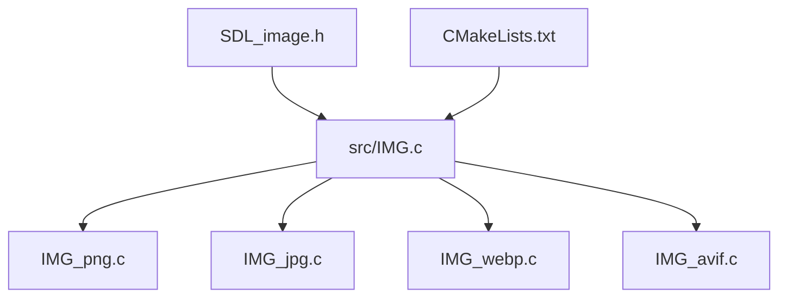

# libsdl-org/SDL_image

> C library that loads images in many formats as SDL 3 surfaces.

## The problem
Loading BMP, PNG, JPEG or WebP into an SDL program requires as many decoders.

## What it actually does
`IMG.c` detects the format and delegates to the `IMG_xxx.c` decoder. Supported formats: BMP, GIF, JPEG, PNG, QOI, TGA, XCF, XPM, simple SVG, and AVIF, JPEG-XL, TIFF, WebP depending on optional libraries. Built with CMake.

## How it is wired


## Trying it
```bash
# Aucune commande dans le README ; voir INSTALL.md.
```

## Cost and gotchas
Free, Zlib license. Requires SDL 3; modern formats need optional libraries.

## What it is not
Not an image processing tool: it only decodes.

## Alternatives
No alternative named in the README.

## For you
Ignore: a video game building block in C, unrelated to data or AI.
