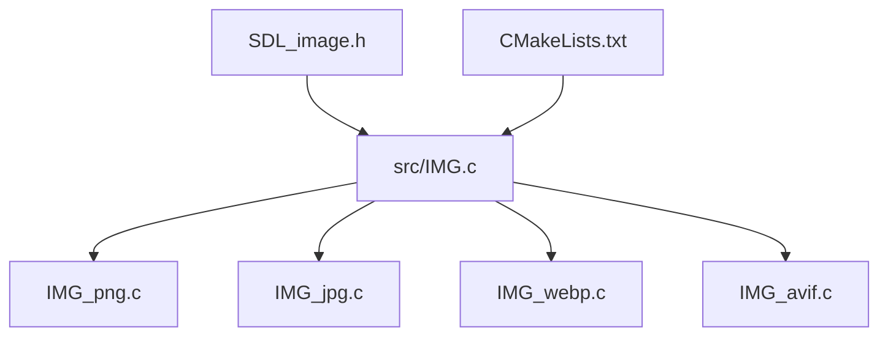

# libsdl-org/SDL_image

> Bibliothèque C qui charge des images de nombreux formats comme surfaces SDL 3.

## Le problème
Charger BMP, PNG, JPEG ou WebP dans un programme SDL demande autant de décodeurs.

## Ce que ça fait vraiment
`IMG.c` détecte le format et délègue au décodeur `IMG_xxx.c`. Formats gérés : BMP, GIF, JPEG, PNG, QOI, TGA, XCF, XPM, SVG simple, et AVIF, JPEG-XL, TIFF, WebP selon des bibliothèques optionnelles. Compilation par CMake.

## Comment c'est branché


## Essayer
```bash
# Aucune commande dans le README ; voir INSTALL.md.
```

## Coût et pièges
Gratuit, licence Zlib. Il faut SDL 3 ; les formats modernes exigent des bibliothèques optionnelles.

## Ce que ce n'est pas
Pas un outil de traitement d'image : il décode seulement.

## Alternatives
Aucune alternative nommée dans le README.

## Pour toi
Ignorer : brique de jeu vidéo en C, sans rapport avec la data ou l'IA.

