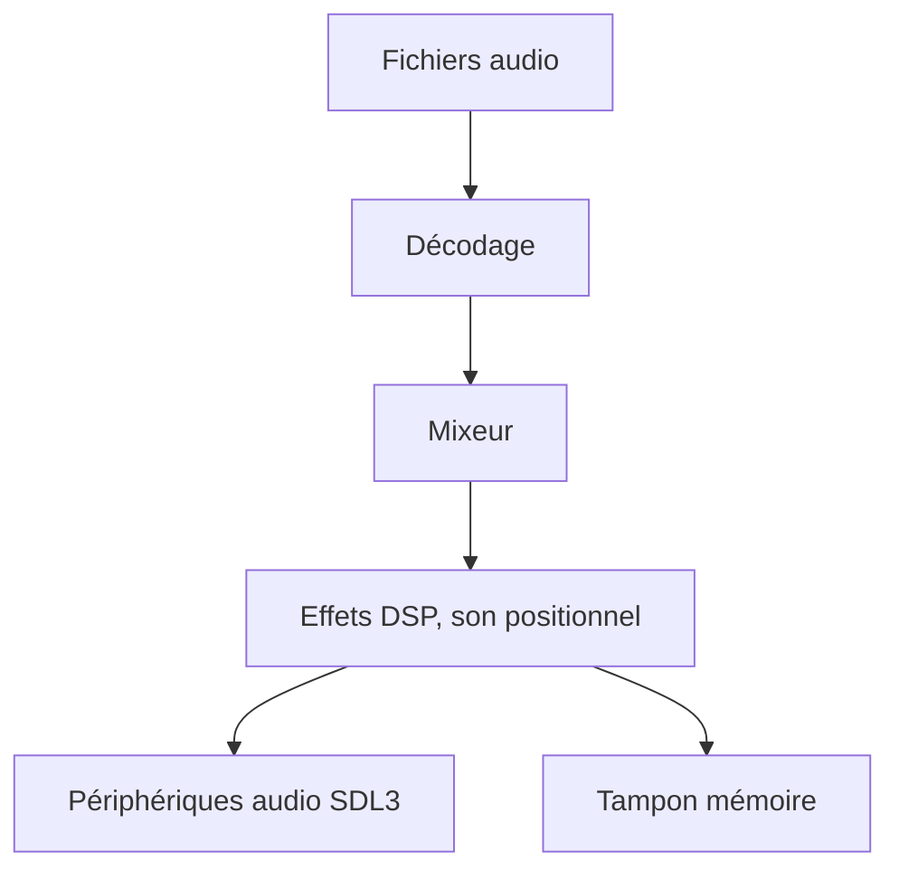

# libsdl-org/SDL_mixer

> SDL3 audio library: decoding, mixing, effects and positional sound, for game or application developers.

## The problem
Playing several audio formats with mixing and effects requires a lot of low-level code.

## What it actually does
SDL3_mixer decodes many formats, mixes tracks and applies DSP effects and positional sound. Data is preloaded or streamed on the fly, to several devices or to a memory buffer. It is an almost complete rewrite of SDL2_mixer.

## How it is wired
Simplified diagram based on the sheet, no diagram provided.

## Trying it
No command documented in the README: see `INSTALL.md`.

## Cost and gotchas
Free. Requires SDL 3.4.0 or later. The API is incompatible with SDL2_mixer: see `docs/README-migration.md`. C compilation expected (not documented here).

## What it is not
Not a ready-to-use audio player nor an AI tool. It is not compatible with the SDL2_mixer API.

## Alternatives
No alternative cited in the README.

## For you
Ignore: low-level audio library unrelated to data or AI.
