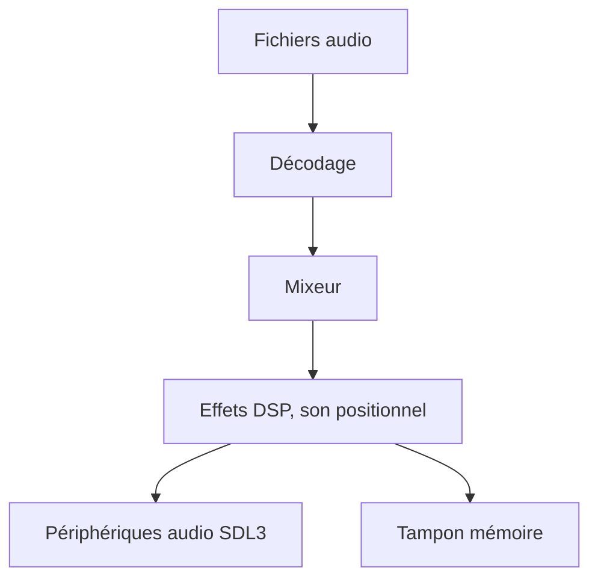

# libsdl-org/SDL_mixer

> Bibliothèque audio SDL3 : décodage, mixage, effets et son positionnel, pour développeurs de jeux ou d'applications.

## Le problème
Jouer plusieurs formats audio avec mixage et effets demande beaucoup de code bas niveau.

## Ce que ça fait vraiment
SDL3_mixer décode de nombreux formats, mélange les pistes et applique des effets DSP et du son positionnel. Les données sont préchargées ou diffusées à la volée, sur plusieurs périphériques ou vers un tampon mémoire. C'est une réécriture presque complète de SDL2_mixer.

## Comment c'est branché
Schéma simplifié d'après la fiche, sans diagramme fourni.

## Essayer
Aucune commande documentée dans le README : voir `INSTALL.md`.

## Coût et pièges
Gratuit. Il faut SDL 3.4.0 ou plus. L'API est incompatible avec SDL2_mixer : voir `docs/README-migration.md`. Compilation C attendue (non documentée ici).

## Ce que ce n'est pas
Pas un lecteur audio prêt à l'emploi ni un outil pour l'IA. Ce n'est pas compatible avec l'API de SDL2_mixer.

## Alternatives
Aucune alternative citée dans le README.

## Pour toi
À ignorer : bibliothèque audio de bas niveau sans lien avec la donnée ou l'IA.

