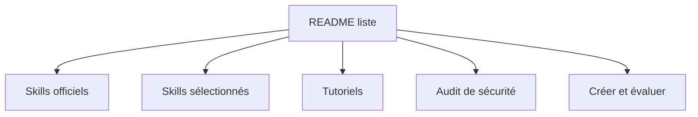

# libukai/awesome-agent-skills

> Annotated list of agent skills, tutorials and best practices for writing your own.

## The problem
Agent skills are scattered across vendors, marketplaces and personal repos, with no sorting or security advice.

## What it actually does
The repo explains the structure of a skill (`SKILL.md`, scripts, references, resources) and progressive loading. It lists official skills (Anthropic, OpenAI, Hugging Face, Supabase…) and skills picked by category, plus tutorials. A security audit section and a section on creating and evaluating skills complete the whole.

## How it is wired
Simplified diagram based on the sheet, no diagram provided.



## Trying it
```bash
npx skills find [query]
npx skills add <owner/repo> --list
gh skill preview <owner/repo> <skill>
```

## Cost and gotchas
Free, but no license declared. The listed skills can run scripts and access files or accounts: the README recommends inspecting each skill and pinning a version.

## What it is not
It is not a tool or a package: it is a list. Inclusion in the list proves neither security nor quality, as the README itself says.

## Alternatives
- vercel-labs/skills: command-line tool to install and manage skills.
- skillsmp and skills.sh: named marketplaces and rankings.

## For you
Adopt as an entry point to find and write skills, especially for its sections on evaluation and security; check each skill before use.
