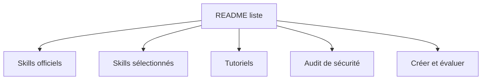

# libukai/awesome-agent-skills

> Liste commentée de skills d'agents, de tutoriels et de bonnes pratiques pour écrire les siens.

## Le problème
Les skills d'agents sont dispersés entre éditeurs, places de marché et dépôts personnels, sans tri ni conseils de sécurité.

## Ce que ça fait vraiment
Le dépôt explique la structure d'un skill (`SKILL.md`, scripts, références, ressources) et le chargement progressif. Il liste des skills officiels (Anthropic, OpenAI, Hugging Face, Supabase…) et des skills choisis par catégorie, plus des tutoriels. Une section audit de sécurité et une section sur la création et l'évaluation de skills complètent l'ensemble.

## Comment c'est branché
Schéma simplifié d'après la fiche, sans diagramme fourni.



## Essayer
```bash
npx skills find [query]
npx skills add <owner/repo> --list
gh skill preview <owner/repo> <skill>
```

## Coût et pièges
Gratuit, mais aucune licence déclarée. Les skills listés peuvent exécuter des scripts et accéder à des fichiers ou comptes : le README recommande d'inspecter chaque skill et d'épingler une version.

## Ce que ce n'est pas
Ce n'est pas un outil ni un paquet : c'est une liste. L'inclusion dans la liste ne prouve ni sécurité ni qualité, comme le README le dit lui-même.

## Alternatives
- vercel-labs/skills : outil en ligne de commande pour installer et gérer les skills.
- skillsmp et skills.sh : places de marché et classements nommés.

## Pour toi
À adopter comme point d'entrée pour trouver et écrire des skills, surtout pour ses sections sur l'évaluation et la sécurité ; vérifie chaque skill avant usage.

