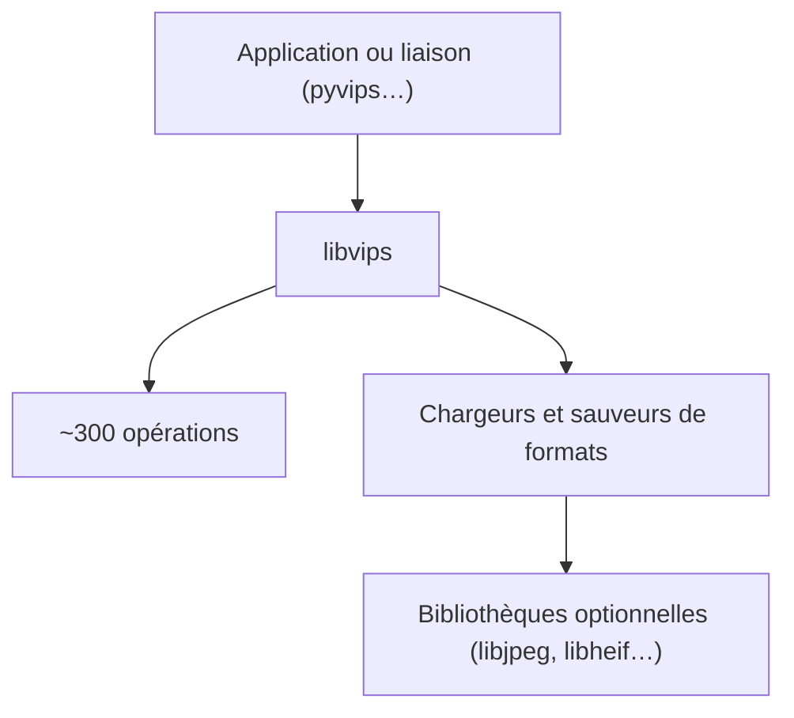

# libvips/libvips

> Low-memory image processing library, with bindings for many languages including Python.

## The problem
Processing many or large images with conventional tools consumes a lot of memory and time.

## What it actually does
An on-demand, multithreaded engine with about 300 operations (arithmetic, histograms, convolution, color, resampling). It reads many formats (JPEG, PNG, WebP, HEIC, AVIF, TIFF, PDF, OpenSlide…). Bindings exist notably for Python (pyvips), Ruby, PHP and Go; sharp, Mastodon and imgproxy use it.

## How it is wired
Simplified diagram based on the sheet, no diagram provided.


## Trying it
```bash
meson setup build --prefix /my/install/prefix
cd build
meson compile
meson test
meson install
```

## Cost and gotchas
Free. Built with Meson, ninja, pkg-config, glib and expat; formats depend on the optional libraries found. Untrusted images require thinking about ImageMagick's attack surface.

## What it is not
Not an image editor nor a computer vision library: it processes and converts pixels, with no model.

## Alternatives
- ImageMagick and GraphicsMagick: cited as fallback loaders, with more attack surface.

## For you
Keep an eye on it: relevant for preprocessing large volumes of images in a pipeline via pyvips, without making it a central tool.
