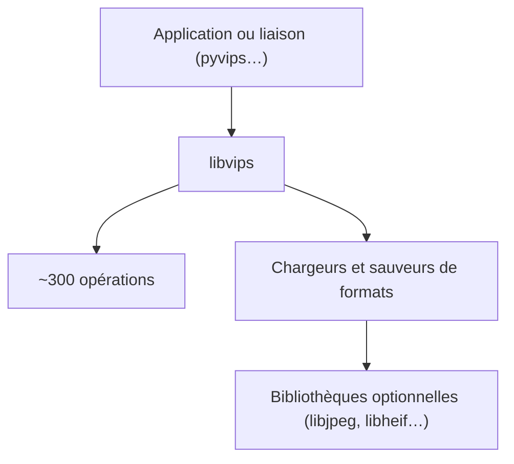

# libvips/libvips

> Bibliothèque de traitement d'images à faible mémoire, avec liaisons pour de nombreux langages dont Python.

## Le problème
Traiter beaucoup ou de grandes images avec des outils classiques consomme beaucoup de mémoire et de temps.

## Ce que ça fait vraiment
Un moteur à la demande et multithreadé avec environ 300 opérations (arithmétique, histogrammes, convolution, couleur, rééchantillonnage). Il lit de nombreux formats (JPEG, PNG, WebP, HEIC, AVIF, TIFF, PDF, OpenSlide…). Des liaisons existent notamment pour Python (pyvips), Ruby, PHP et Go ; sharp, Mastodon et imgproxy l'utilisent.

## Comment c'est branché
Schéma simplifié d'après la fiche, sans diagramme fourni.


## Essayer
```bash
meson setup build --prefix /my/install/prefix
cd build
meson compile
meson test
meson install
```

## Coût et pièges
Gratuit. Compilation avec Meson, ninja, pkg-config, glib et expat ; les formats dépendent des bibliothèques optionnelles trouvées. Les images non fiables imposent de réfléchir à la surface d'attaque d'ImageMagick.

## Ce que ce n'est pas
Pas un éditeur d'images ni une bibliothèque de vision par ordinateur : elle traite et convertit des pixels, sans modèle.

## Alternatives
- ImageMagick et GraphicsMagick : cités comme chargeurs de repli, avec plus de surface d'attaque.

## Pour toi
À surveiller : pertinent pour prétraiter de gros volumes d'images en pipeline via pyvips, sans en faire un outil central.

