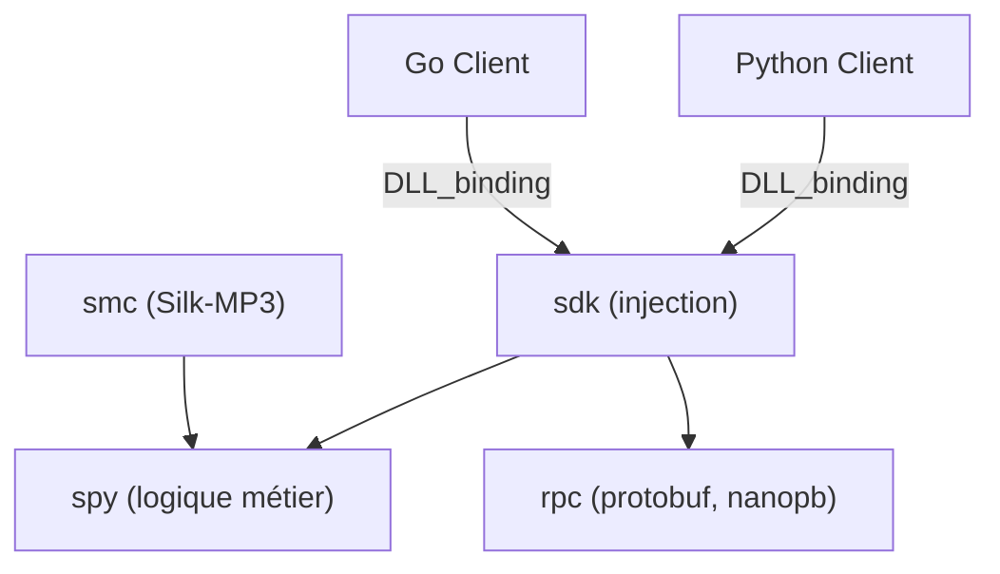

# lich0821/WeChatFerry

> Windows library that injects itself into the WeChat client to drive it from Python, Go, Node or Rust.

## The problem
WeChat offers no public API to automate messages, contacts and groups.

## What it actually does
A DLL is injected into WeChat (3.9.x versions) and exposes over protobuf RPC: login QR code, sending text, images and files, reading messages, database queries, adding contacts and group members. Clients exist in Python (pip wcferry), HTTP, Java, Node, C# and Rust. The repository is archived.

## How it is wired


## Trying it
```bash
pip install --upgrade wcferry
```
Provided example: WeChatRobot, a Python bot. Build: Visual Studio 2019 and vcpkg.

## Cost and gotchas
Free, Windows only. Depends on specific WeChat versions, so it will break with every client update. A disclaimer should be read before use.

## What it is not
Not an official WeChat API and not a maintained project. Use may violate the service's rules, which the README does not specify.

## Alternatives
No alternative named in the README.

## For you
Ignore: archived, fragile and tied to WeChat, with no link to data or MLOps work.
