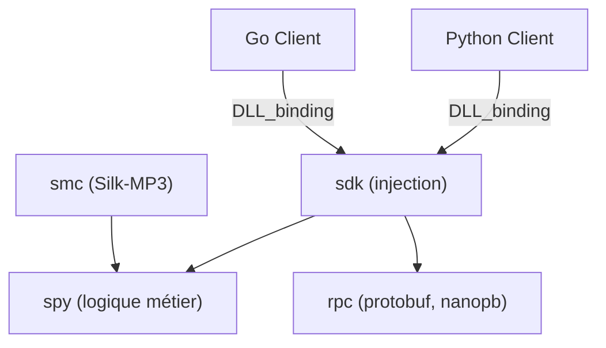

# lich0821/WeChatFerry

> Bibliothèque Windows qui s'injecte dans le client WeChat pour le piloter depuis Python, Go, Node ou Rust.

## Le problème
WeChat n'offre pas d'API publique pour automatiser messages, contacts et groupes.

## Ce que ça fait vraiment
Une DLL est injectée dans WeChat (versions 3.9.x) et expose en RPC protobuf : QR de connexion, envoi de textes, images et fichiers, lecture de messages, requêtes sur les bases, ajout de contacts et de membres de groupe. Des clients existent en Python (pip wcferry), HTTP, Java, Node, C# et Rust. Le dépôt est archivé.

## Comment c'est branché


## Essayer
```bash
pip install --upgrade wcferry
```
Exemple fourni : WeChatRobot, bot Python. Build : Visual Studio 2019 et vcpkg.

## Coût et pièges
Gratuit, Windows uniquement. Dépend de versions précises de WeChat, donc cassera à chaque mise à jour du client. Une clause de non-responsabilité est à lire avant usage.

## Ce que ce n'est pas
Pas une API officielle de WeChat et pas un projet maintenu. Utilisation susceptible de contrevenir aux règles du service, non précisé dans le README.

## Alternatives
Aucune alternative nommée dans le README.

## Pour toi
À ignorer : archivé, fragile et réservé à WeChat, sans lien avec un travail data ou MLOps.

