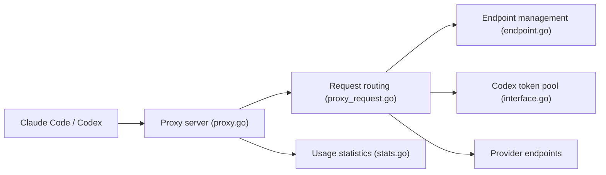

# lich0821/ccNexus

> Local proxy that routes Claude Code and Codex to multiple endpoints, with failover and format conversion.

## The problem
An AI coding client is tied to a single provider: if the endpoint goes down, or if the API format differs, everything stops.

## What it actually does
Receives a client's requests, picks an endpoint, converts between Claude, OpenAI and Gemini formats as needed, then forwards. Automatic rotation on failure, a Codex token pool with refresh, usage statistics, WebDAV synchronization, headless server mode with Basic Auth. Listens on port 3000.

## How it is wired


## Trying it
```bash
tar -xzf ccNexus-linux-amd64.tar.gz && ./ccNexus
```

## Cost and gotchas
Free; provider keys remain at your expense. In server mode, expose it only on a trusted network or behind TLS. README in Chinese.

## What it is not
Not a model provider. The Codex token pool bulk-imports credentials: check that this complies with the relevant terms of service.

## Alternatives
No alternative named in the README.

## For you
Worth watching: useful for juggling several AI coding endpoints; keep an eye on the terms-of-use risk around the tokens.
