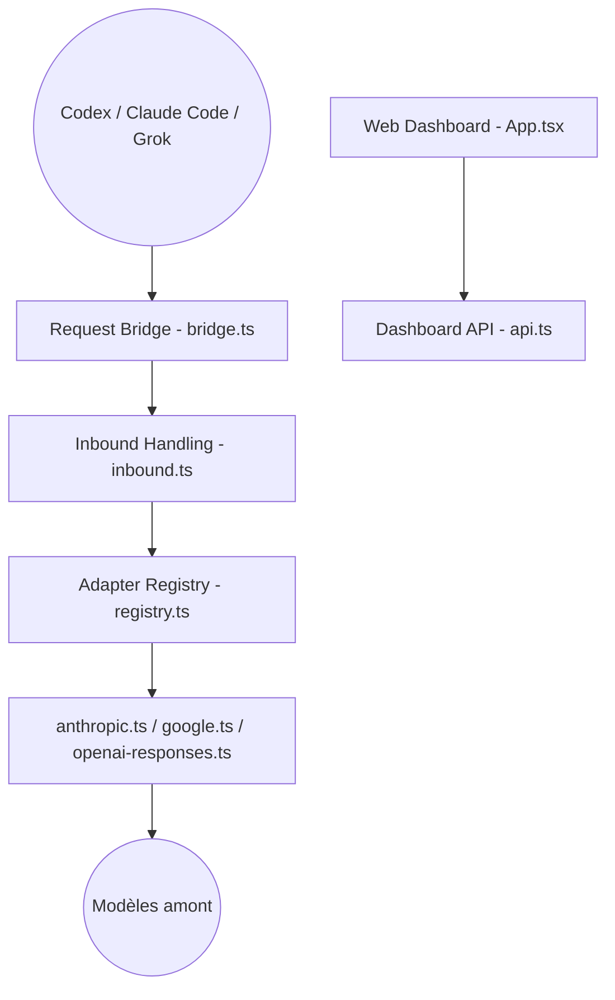

# lidge-jun/opencodex

> Local gateway that lets Codex, Claude Code or Grok Build talk to any model provider.

## The problem
Each coding tool is tied to its provider. Switching models or spreading load across accounts requires manual configuration.

## What it actually does
A local proxy receives the Responses, Chat Completions and Anthropic Messages APIs and translates them to more than 40 providers. Provides a web dashboard (port 10100), "combos" with failover or load spreading, a pool of ChatGPT accounts and `provider/model` routing. A desktop app (beta) also exists.

## How it is wired


## Trying it
```bash
npm install -g --allow-scripts=bun @bitkyc08/opencodex
ocx start
ocx claude
codex -m "anthropic/claude-opus-5" "Explain this stack trace"
ocx stop
```

## Cost and gotchas
Node 18+; the Bun runtime is included. You pay the providers with your own keys. Anthropic may suspend an account that goes through a third-party proxy (README warning). An anonymous usage summary is sent every day unless you opt out (`ocx telemetry disable`). Outside loopback, a token is mandatory.

## What it is not
Not a model provider. Not affiliated with OpenAI or Anthropic. The account pool is not a protection against provider limits.

## Alternatives
No alternative named in the README.

## For you
Handy if you juggle several LLMs in your coding agents; worth watching because of the account suspension risk and the dependence on a single maintainer.
