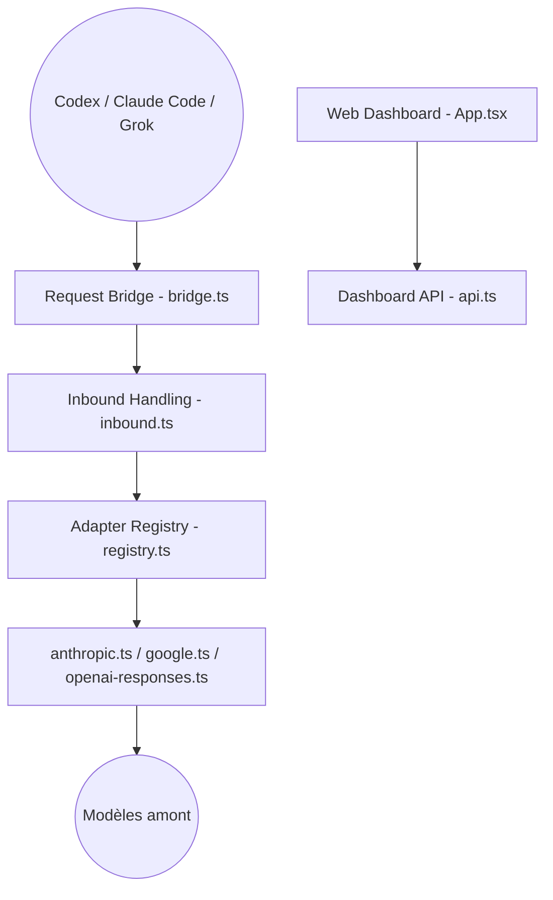

# lidge-jun/opencodex

> Passerelle locale qui fait parler Codex, Claude Code ou Grok Build à n'importe quel fournisseur de modèles.

## Le problème
Chaque outil de code est lié à son fournisseur. Changer de modèle ou répartir la charge entre comptes demande de la configuration manuelle.

## Ce que ça fait vraiment
Un proxy local reçoit les API Responses, Chat Completions et Anthropic Messages et les traduit vers plus de 40 fournisseurs. Fournit un tableau de bord web (port 10100), des « combos » avec bascule ou répartition, un pool de comptes ChatGPT et un routage `provider/model`. Une application de bureau (bêta) existe aussi.

## Comment c'est branché


## Essayer
```bash
npm install -g --allow-scripts=bun @bitkyc08/opencodex
ocx start
ocx claude
codex -m "anthropic/claude-opus-5" "Explain this stack trace"
ocx stop
```

## Coût et pièges
Node 18+ ; le runtime Bun est inclus. Tu paies les fournisseurs avec tes clés. Anthropic peut suspendre un compte qui passe par un proxy tiers (avertissement du README). Un résumé d'usage anonyme est envoyé chaque jour sauf refus (`ocx telemetry disable`). Hors loopback, un jeton est obligatoire.

## Ce que ce n'est pas
Pas un fournisseur de modèles. Pas affilié à OpenAI ni Anthropic. Le pool de comptes n'est pas une protection contre les limites des fournisseurs.

## Alternatives
Aucune alternative nommée dans le README.

## Pour toi
Pratique si tu jongles entre plusieurs LLM dans tes agents de code ; à surveiller à cause du risque de suspension de compte et de la dépendance à un mainteneur unique.

