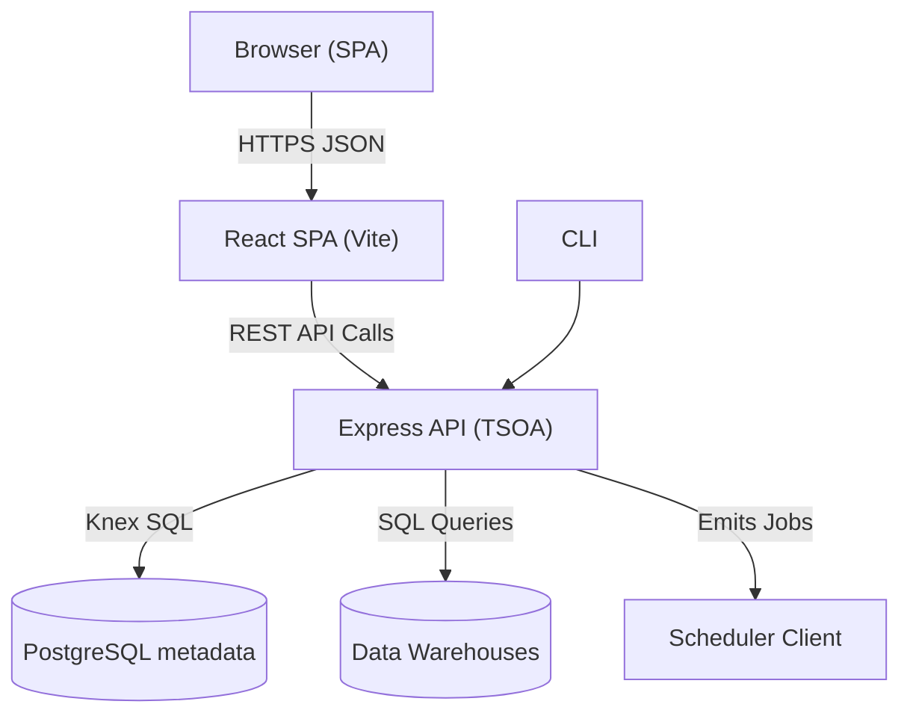

# lightdash/lightdash

> Open source BI platform for data teams: governed metrics, dashboards and AI agents, driven by Git.

## The problem
Metrics are redefined in every tool and analyses go through neither Git, code review, nor CI.

## What it actually does
A context layer (metrics, joins, permissions) defined on dbt or in YAML feeds dashboards, AI agents, data apps and embedded analytics. The CLI enables `lightdash preview` and `lightdash validate` in CI, and an MCP server gives context to coding agents. The application is a TypeScript monorepo: Express and TSOA API, React interface, PostgreSQL for metadata, and adapters for the BigQuery, Snowflake, Redshift and other warehouses.

## How it is wired


## Trying it
```bash
lightdash install-skills
lightdash preview
lightdash validate
git clone https://github.com/lightdash/lightdash.git
cd lightdash
./scripts/install.sh
```

## Cost and gotchas
The catalog notes a license that is present but not identified by GitHub: to be checked. Enterprise features on a self-hosted instance require a paid license key. The recommended path is Lightdash Cloud; self-hosting requires Docker or Kubernetes and an existing data warehouse.

## What it is not
Not a data warehouse nor a transformation tool: it relies on a warehouse and on dbt. AI agents, data apps and other features are presented as a showcase of the Cloud or Enterprise offering.

## Alternatives
The README does not cite a named alternative.

## For you
Keep an eye on it: very well suited if your team already has dbt and wants versioned BI, provided you read the license and know which features are paid.
