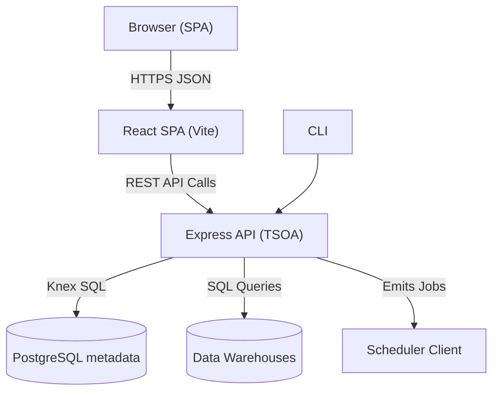

# lightdash/lightdash

> Plateforme de BI open source pour équipes data : métriques gouvernées, tableaux de bord et agents IA, pilotés par Git.

## Le problème
Les métriques sont redéfinies dans chaque outil et les analyses ne passent ni par Git, ni par la revue de code, ni par la CI.

## Ce que ça fait vraiment
Une couche de contexte (métriques, jointures, permissions) définie sur dbt ou en YAML alimente tableaux de bord, agents IA, applications de données et analytique embarquée. La CLI permet `lightdash preview` et `lightdash validate` en CI, et un serveur MCP donne le contexte aux agents de code. L'application est un monorepo TypeScript : API Express et TSOA, interface React, PostgreSQL pour les métadonnées, et des adaptateurs pour les entrepôts BigQuery, Snowflake, Redshift et autres.

## Comment c'est branché


## Essayer
```bash
lightdash install-skills
lightdash preview
lightdash validate
git clone https://github.com/lightdash/lightdash.git
cd lightdash
./scripts/install.sh
```

## Coût et pièges
Le catalogue relève une licence présente mais non identifiée par GitHub : à vérifier. Les fonctions enterprise sur une instance auto-hébergée exigent une clé de licence payante. La voie recommandée est Lightdash Cloud ; l'auto-hébergement demande Docker ou Kubernetes et un entrepôt de données existant.

## Ce que ce n'est pas
Ce n'est pas un entrepôt de données ni un outil de transformation : il s'appuie sur un entrepôt et sur dbt. Les agents IA, les applications de données et d'autres fonctions sont présentés comme vitrine de l'offre Cloud ou Enterprise.

## Alternatives
Le README ne cite pas d'alternative nommée.

## Pour toi
À surveiller : très adapté si ton équipe a déjà dbt et veut une BI versionnée, à condition de lire la licence et de savoir quelles fonctions sont payantes.

