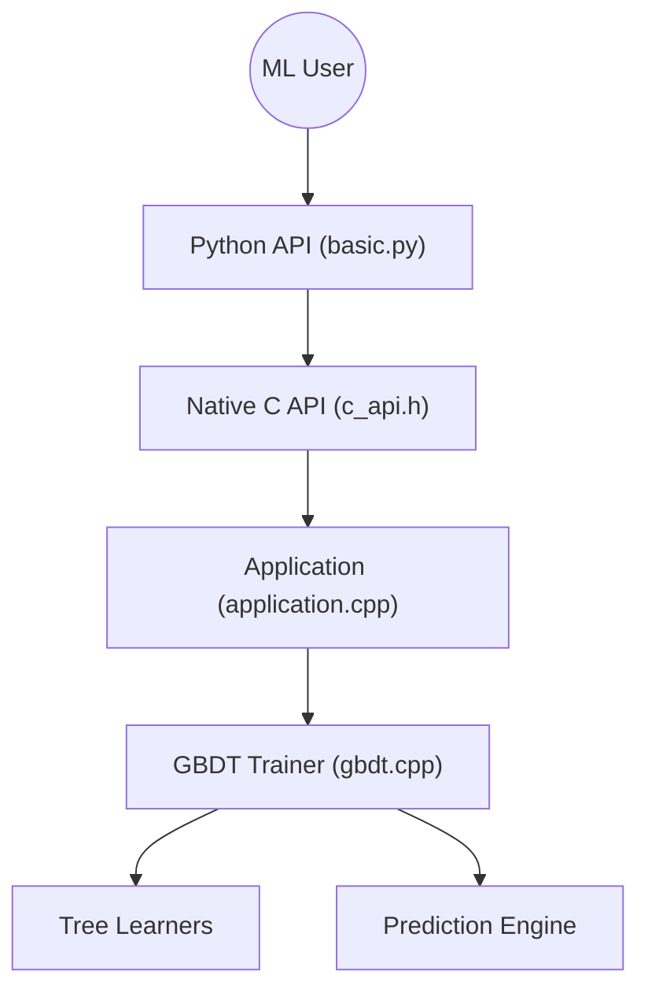

# lightgbm-org/LightGBM

> Fast, distributable tree-based gradient boosting library for tabular data.

## The problem
Training models on large tabular datasets with classic GBDTs is slow and memory-hungry.

## What it actually does
C++ core that loads the data, builds feature histograms, grows trees according to an objective function, evaluates metrics and writes a model, then predicts. It is used from the command line, in Python (native API, cross-validation, scikit-learn, Dask), in R or via the C API. Distributed and GPU training are supported.

## How it is wired

## Trying it
No command in the README: installation is deferred to https://lightgbm.readthedocs.io/. To write: `pip install lightgbm`.

## Cost and gotchas
Free. GPU and distributed training require a dedicated installation and configuration. The repository changed address in March 2026 (`Microsoft/LightGBM` to `lightgbm-org/LightGBM`).

## What it is not
Not an AutoML or experiment tracking tool: the README lists unofficial projects (FLAML, Optuna, MLflow) for that. Not suited to images or raw text.

## Alternatives
- dmlc/xgboost: not cited in the README.
- microsoft/FLAML: automatic tuning cited.
- optuna/optuna: hyperparameter optimization cited.

## For you
Adopt: proven reference for tabular data, MIT license, many surrounding ecosystems, hence a safe default choice.
