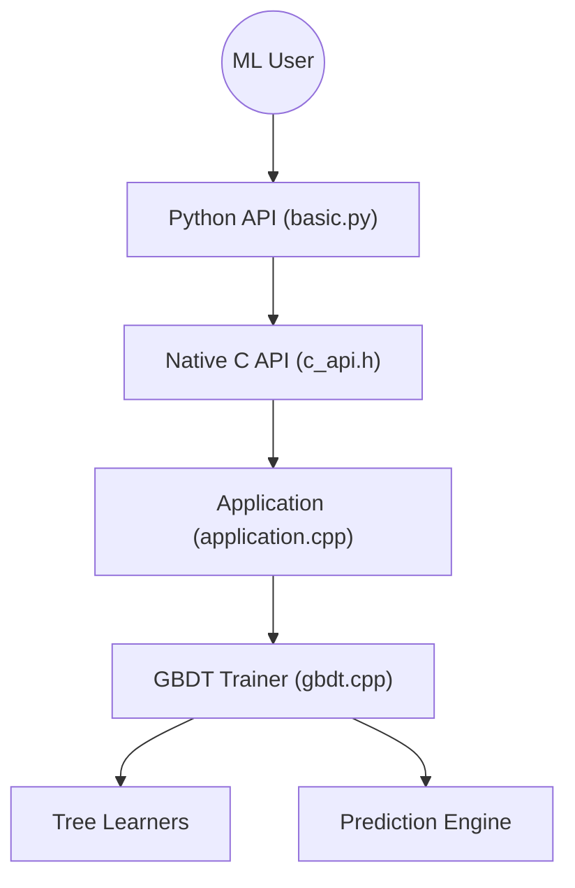

# lightgbm-org/LightGBM

> Bibliothèque de gradient boosting sur arbres, rapide et distribuable, pour données tabulaires.

## Le problème
Entraîner des modèles sur de grands jeux tabulaires avec des GBDT classiques est lent et gourmand en mémoire.

## Ce que ça fait vraiment
Noyau C++ qui charge les données, construit des histogrammes de features, fait pousser les arbres selon une fonction objectif, évalue des métriques et écrit un modèle, puis prédit. Il s'utilise en ligne de commande, en Python (API native, validation croisée, scikit-learn, Dask), en R ou via l'API C. L'apprentissage distribué et GPU est pris en charge.

## Comment c'est branché

## Essayer
Aucune commande dans le README : l'installation est renvoyée à https://lightgbm.readthedocs.io/. À écrire : `pip install lightgbm`.

## Coût et pièges
Gratuit. Le GPU et le distribué demandent une installation et une configuration dédiées. Le dépôt a changé d'adresse en mars 2026 (`Microsoft/LightGBM` vers `lightgbm-org/LightGBM`).

## Ce que ce n'est pas
Pas un outil d'AutoML ni de suivi d'expériences : le README liste des projets non officiels (FLAML, Optuna, MLflow) pour cela. Pas adapté aux images ou au texte brut.

## Alternatives
- dmlc/xgboost : non cité dans le README.
- microsoft/FLAML : réglage automatique cité.
- optuna/optuna : optimisation d'hyperparamètres citée.

## Pour toi
À adopter : référence éprouvée du tabulaire, licence MIT, nombreux écosystèmes autour, donc un choix par défaut sûr.

