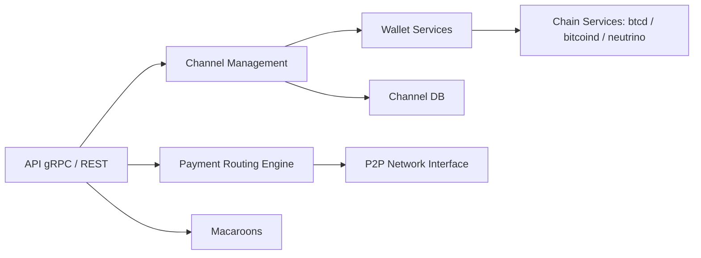

# lightningnetwork/lnd

> Full Lightning Network node in Go, for people who manage Bitcoin payment channels.

## The problem
Taking part in the Lightning Network requires a daemon that manages channels, routing and the Bitcoin chain without an intermediary.

## What it actually does
Opens and closes channels, manages all their states, maintains the validated channel graph, computes paths and relays or sends onion-encrypted payments. Exposes a gRPC and REST API. The code also describes a watchtower, macaroons and autopilot.

## How it is wired


## Trying it
```bash
# Aucune commande de build dans le README : voir docs/INSTALL.md
```
The README points to docs/INSTALL.md and the Docker instructions.

## Cost and gotchas
A chain backend (btcd, bitcoind or neutrino) and real funds are required; the README describes the software as beta and warns of possible loss of funds if the security guidance is ignored (docs/safety.md).

## What it is not
It is not a consumer wallet nor a data tool. The APIs are not stable. Mainnet puts real money at stake.

## Alternatives
No alternative named in the README.

## For you
Ignore: Bitcoin/payments domain unrelated to a data/AI/MLOps profile, unless you have a specific Lightning project.
