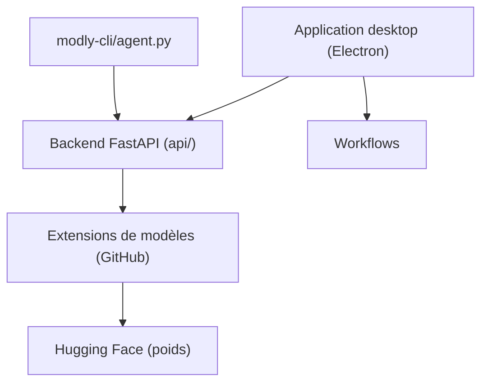

# lightningpixel/modly

> Desktop application that turns a photo into a 3D mesh with open source models on your GPU.

## The problem
Generating a 3D model from an image often goes through cloud services or manual model installations.

## What it actually does
Electron application with a Python (FastAPI) backend and a workflow editor (Image, Generate a mesh, Add to scene). Models are installed as GitHub extensions (Hunyuan3D 2 Mini, TripoSG, Trellis2 GGUF). Weights downloaded from Hugging Face, with quantization variants. CLI for agents (`tools/modly-cli/agent.py`).

## How it is wired


## Trying it
```bash
npm install
cd api
python -m venv .venv
source .venv/bin/activate
pip install -r requirements.txt
npm run dev
```
Or `./launch.sh` (Linux/macOS), `launch.bat` (Windows).

## Cost and gotchas
A GPU is required (AMD via ROCm, Apple Silicon). Large weight downloads. License present but not identified by GitHub: read it before use.

## What it is not
Not a model: an extension launcher. Each model keeps its own license.

## Alternatives
No alternative named in the README.

## For you
Worth watching: handy for testing image-to-3D locally, but the license needs clarifying and the project is a single person's.
