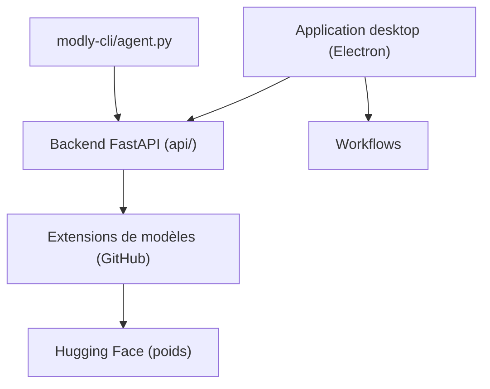

# lightningpixel/modly

> Application bureau qui transforme une photo en maillage 3D avec des modèles open source sur ton GPU.

## Le problème
Générer un modèle 3D à partir d'une image passe souvent par des services cloud ou des installations manuelles de modèles.

## Ce que ça fait vraiment
Application Electron avec backend Python (FastAPI) et éditeur de workflows (Image, Générer un maillage, Ajouter à la scène). Les modèles s'installent comme extensions GitHub (Hunyuan3D 2 Mini, TripoSG, Trellis2 GGUF). Poids téléchargés depuis Hugging Face, variantes de quantification. CLI pour agents (`tools/modly-cli/agent.py`).

## Comment c'est branché


## Essayer
```bash
npm install
cd api
python -m venv .venv
source .venv/bin/activate
pip install -r requirements.txt
npm run dev
```
Ou `./launch.sh` (Linux/macOS), `launch.bat` (Windows).

## Coût et pièges
GPU nécessaire (AMD via ROCm, Apple Silicon). Téléchargements de poids volumineux. Licence présente mais non identifiée par GitHub : à lire avant usage.

## Ce que ce n'est pas
Pas un modèle : un lanceur d'extensions. Chaque modèle garde sa propre licence.

## Alternatives
Aucune alternative nommée dans le README.

## Pour toi
Surveiller : pratique pour tester l'image vers 3D en local, mais licence à clarifier et projet d'une seule personne.

