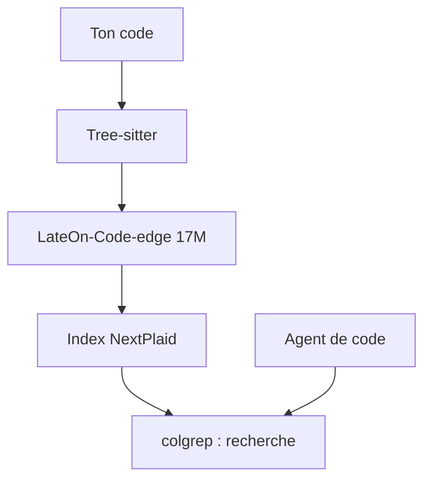

# lightonai/next-plaid

> ColGREP: local semantic code search for the terminal and agents, built on the NextPlaid multi-vector database.

## The problem
grep does not understand meaning, and sending your code to an embeddings service exposes the repository. An agent also spends a lot of context on searching.

## What it actually does
`colgrep` indexes a project with Tree-sitter, encodes each code unit with a lightweight ColBERT model (LateOn-Code-edge, 17M, on CPU), then searches by combining regex and semantic ranking. The `--agent` mode delegates a question to a small local model. NextPlaid, the underlying multi-vector database, can also be used on its own through a REST API (Docker, Python client).

## How it is wired


## Trying it
```bash
brew install lightonai/tap/colgrep && colgrep --install-agent
colgrep init
colgrep "database connection pooling"
colgrep --agent "where is the database connection pool configured"
```

## Cost and gotchas
Free, local. `--install-agent` downloads a 2.5 GB model once; the agent runs on GPU or CPU. The NextPlaid server requires Docker (CPU or CUDA images).

## What it is not
Not an off-the-shelf document RAG: ColGREP targets code, NextPlaid is the generic engine. The benchmarks shown are the author's own.

## Alternatives
- FastPlaid: batch GPU indexing, for massive offline work.
- Semble: the public benchmark ColGREP compares itself against.

## For you
Adopt on a trial basis: 100% local code search, pluggable into Claude Code, directly useful for an AI / MLOps profile.
