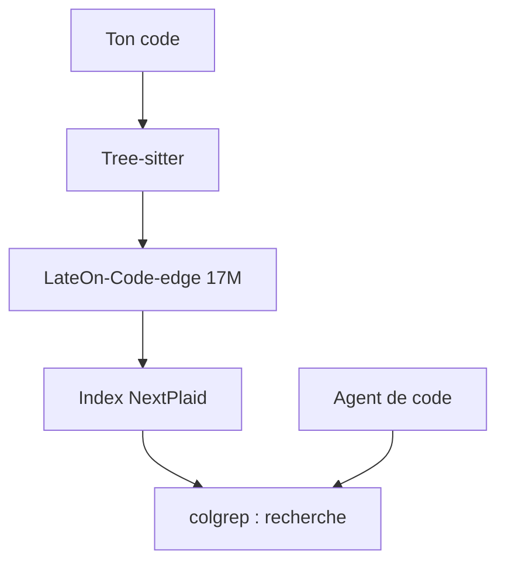

# lightonai/next-plaid

> ColGREP : recherche sémantique de code locale pour terminal et agents, sur une base multi-vecteurs NextPlaid.

## Le problème
grep ne comprend pas le sens, et envoyer son code à un service d'embeddings expose le dépôt. Un agent dépense aussi beaucoup de contexte à chercher.

## Ce que ça fait vraiment
`colgrep` indexe un projet avec Tree-sitter, encode chaque unité de code avec un modèle ColBERT léger (LateOn-Code-edge, 17M, sur CPU), puis cherche en combinant regex et classement sémantique. Le mode `--agent` délègue une question à un petit modèle local. NextPlaid, la base multi-vecteurs sous-jacente, s'utilise aussi seule via une API REST (Docker, client Python).

## Comment c'est branché


## Essayer
```bash
brew install lightonai/tap/colgrep && colgrep --install-agent
colgrep init
colgrep "database connection pooling"
colgrep --agent "where is the database connection pool configured"
```

## Coût et pièges
Gratuit, local. `--install-agent` télécharge un modèle de 2,5 Go une seule fois ; l'agent tourne sur GPU ou CPU. Le serveur NextPlaid demande Docker (images CPU ou CUDA).

## Ce que ce n'est pas
Pas un RAG de documents prêt à l'emploi : ColGREP vise le code, NextPlaid est le moteur générique. Les benchmarks affichés sont ceux de l'auteur.

## Alternatives
- FastPlaid : indexation GPU en lot, pour du hors-ligne massif.
- Semble : le banc public sur lequel ColGREP se compare.

## Pour toi
Adopter à l'essai : recherche de code 100 % locale, branchable sur Claude Code, directement utile à un profil IA / MLOps.

