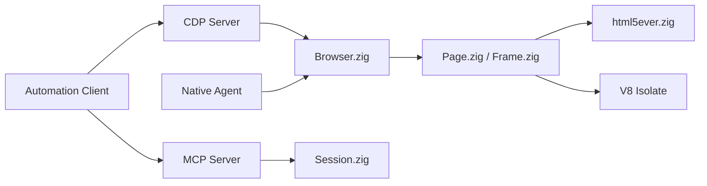

# lightpanda-io/browser

> Headless browser written in Zig, with no graphical rendering, for AI agents and JavaScript scraping.

## The problem
Headless Chrome uses a lot of RAM and CPU when you run hundreds of instances. A simple HTTP client is no longer enough against the JavaScript-rendered web.

## What it actually does
A brand-new browser (neither Chromium nor WebKit) with V8, html5ever (Rust) and libcurl, without a rendering engine. It exposes CDP (Puppeteer/Playwright), WebDriver BiDi and an MCP server, and can dump a page as HTML, Markdown or structured JSON. An `agent` mode drives the browser with an LLM and exports the session as a script replayable without a model. README figures: 123 MB versus 2 GB for 100 pages, 5 s versus 46 s (vendor benchmark).

## How it is wired


## Trying it
```bash
docker run -d --name lightpanda -p 127.0.0.1:9222:9222 lightpanda/browser:latest
./lightpanda fetch --obey-robots --dump markdown https://demo-browser.lightpanda.io/campfire-commerce/
./lightpanda serve --obey-robots --host 127.0.0.1 --port 9222
./lightpanda mcp --port 9223
```

## Cost and gotchas
Free; agent mode requires the API key of the chosen provider (or a local model). glibc binary only (no Alpine/musl), no native Windows build (WSL2). Telemetry is enabled by default: `LIGHTPANDA_DISABLE_TELEMETRY=true`.

## What it is not
Not a full Chrome: no graphical rendering, PNG screenshots are rasterized text. Web API coverage remains partial (tracked via the Web Platform Tests). AGPL-3.0 license: restrictive if you embed it in a distributed service.

## Alternatives
- Headless Chrome: maximum compatibility, but far more resource-hungry (compared in the README).

## For you
Adopt for scraping or agents at scale: the RAM savings are real on paper and the CDP protocol spares you from rewriting your scripts, but test compatibility on your sites first and read the AGPL.
