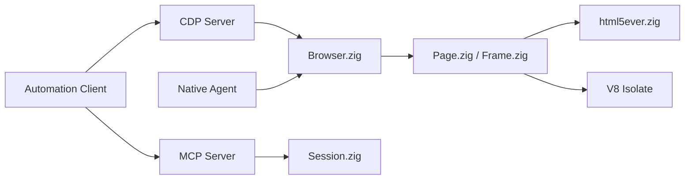

# lightpanda-io/browser

> Navigateur headless écrit en Zig, sans rendu graphique, pour agents IA et scraping en JavaScript.

## Le problème
Chrome headless consomme beaucoup de RAM et de CPU quand on en lance des centaines d'instances. Un simple client HTTP ne suffit plus face au web rendu en JavaScript.

## Ce que ça fait vraiment
Un navigateur neuf (ni Chromium ni WebKit) avec V8, html5ever (Rust) et libcurl, sans moteur de rendu. Il expose CDP (Puppeteer/Playwright), WebDriver BiDi et un serveur MCP, et sait vider une page en HTML, Markdown ou JSON structuré. Un mode `agent` pilote le navigateur avec un LLM et exporte la session en script rejouable sans modèle. Chiffres du README : 123 Mo contre 2 Go pour 100 pages, 5 s contre 46 s (benchmark de l'éditeur).

## Comment c'est branché


## Essayer
```bash
docker run -d --name lightpanda -p 127.0.0.1:9222:9222 lightpanda/browser:latest
./lightpanda fetch --obey-robots --dump markdown https://demo-browser.lightpanda.io/campfire-commerce/
./lightpanda serve --obey-robots --host 127.0.0.1 --port 9222
./lightpanda mcp --port 9223
```

## Coût et pièges
Gratuit ; le mode agent demande la clé d'API du fournisseur choisi (ou un modèle local). Binaire glibc seulement (pas Alpine/musl), pas de build Windows natif (WSL2). La télémétrie est activée par défaut : `LIGHTPANDA_DISABLE_TELEMETRY=true`.

## Ce que ce n'est pas
Pas un Chrome complet : aucun rendu graphique, les captures PNG sont du texte rasterisé. La couverture des API web reste partielle (suivie via les Web Platform Tests). Licence AGPL-3.0 : contraignante si on l'intègre dans un service distribué.

## Alternatives
- Headless Chrome : compatibilité maximale, mais bien plus gourmand (comparé dans le README).

## Pour toi
Adopter pour du scraping ou des agents à grande échelle : l'économie de RAM est réelle sur le papier et le protocole CDP évite de réécrire ses scripts, mais teste d'abord la compatibilité sur tes sites et lis l'AGPL.

