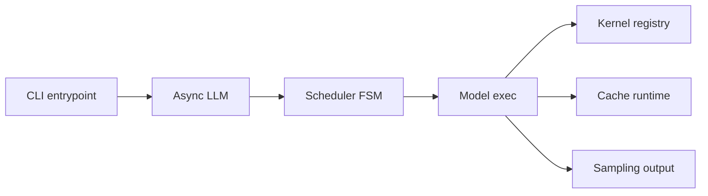

# lightseekorg/tokenspeed

> LLM inference engine for agentic workloads, separating a C++ control plane from Python execution.

## The problem
Existing inference engines mix scheduling and execution, and handle long-running agent workloads poorly.

## What it actually does
A C++ scheduler encodes the request lifecycle and KV cache ownership as a state machine, while execution is in Python. A pluggable kernel layer chooses between CUDA, Triton, FlashInfer and TRT-LLM, including an MLA implementation on Blackwell. The AsyncLLM entry point receives requests; parallelism, MoE, quantization, speculative decoding and prefill/decode separation are planned. The figures comparing it to TensorRT-LLM are the project's own.

## How it is wired


## Trying it
The README gives no command: it points to "Getting Started" and "Launching a Server".
```bash
# aucune commande documentée dans le README
```

## Cost and gotchas
A recent GPU is required; the quoted performance is on B200 with Kimi K2.5. Installation has to be looked up in the external documentation.

## What it is not
Not a tool for a machine without a GPU. Recent project (May 2026); "the highest-performing" is an ambition of the README, not a fact verified here.

## Alternatives
- TensorRT-LLM and vLLM: compared in the README.

## For you
Keep an eye on it: worth following if you serve LLMs on recent GPUs, but vLLM remains the proven choice.
