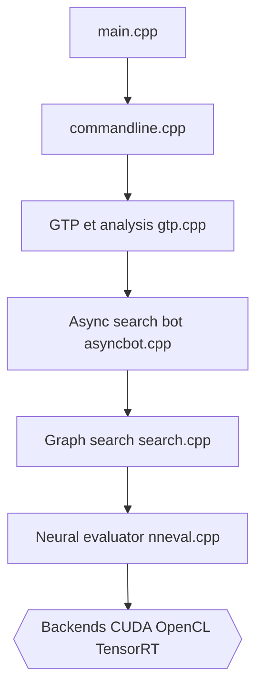

# lightvector/KataGo

> Open source Go engine trained by self-play, with JSON analysis, to plug into a graphical interface.

## The problem
Analyzing Go games with territory and score requires a strong engine, usable from existing interfaces.

## What it actually does
C++ graph-based Monte-Carlo search engine guided by a neural network. It speaks GTP for interfaces, offers a batched JSON analysis engine, and match and self-play commands. Six backends: OpenCL, CUDA, TensorRT, ROCm, ONNX Runtime and Eigen (CPU), plus Metal on macOS. A public distributed training runs on katagotraining.org.

## How it is wired


## Trying it
```bash
./katago.exe benchmark -model <NEURALNET>.bin.gz
./katago.exe genconfig -model <NEURALNET>.bin.gz -output gtp_custom.cfg
./katago.exe gtp -model <NEURALNET>.bin.gz -config gtp_custom.cfg
```

## Cost and gotchas
A network must be downloaded separately. The first OpenCL launch tunes the GPU (seconds to minutes). Mesa drivers, RX 5700 and old Intel graphics cause problems. 512 open issues.

## What it is not
No graphical interface: only an engine. Not a general-purpose AI tool: it is a Go engine, even if self-play is of interest to research.

## Alternatives
- KaTrain: all-in-one interface, simpler for beginners.
- Lizzie and its forks, Sabaki, q5Go, Ogatak: interfaces named in the README.

## For you
Adopt if Go or self-play learning interests you: the C++ and PyTorch pipeline is a good reference, check the license.
