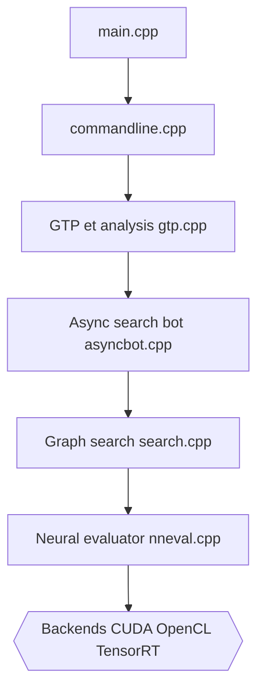

# lightvector/KataGo

> Moteur de Go open source entraîné par auto-jeu, avec analyse JSON, à brancher sur une interface graphique.

## Le problème
Analyser des parties de Go avec territoire et score demande un moteur fort, utilisable depuis des interfaces existantes.

## Ce que ça fait vraiment
Moteur C++ de recherche Monte-Carlo sur graphe guidé par un réseau de neurones. Il parle GTP pour les interfaces, propose un moteur d'analyse JSON par lots, et des commandes de match et d'auto-jeu. Six backends : OpenCL, CUDA, TensorRT, ROCm, ONNX Runtime et Eigen (CPU), plus Metal sur macOS. Un apprentissage distribué public tourne sur katagotraining.org.

## Comment c'est branché


## Essayer
```bash
./katago.exe benchmark -model <NEURALNET>.bin.gz
./katago.exe genconfig -model <NEURALNET>.bin.gz -output gtp_custom.cfg
./katago.exe gtp -model <NEURALNET>.bin.gz -config gtp_custom.cfg
```

## Coût et pièges
Il faut télécharger un réseau séparément. Le premier lancement OpenCL règle le GPU (secondes à minutes). Pilotes Mesa, RX 5700 et graphiques Intel anciens posent problème. 512 issues ouvertes.

## Ce que ce n'est pas
Pas d'interface graphique : seulement un moteur. Pas un outil généraliste d'IA : c'est un moteur de Go, même si l'auto-jeu intéresse la recherche.

## Alternatives
- KaTrain : interface tout-en-un, plus simple pour débuter.
- Lizzie et ses forks, Sabaki, q5Go, Ogatak : interfaces nommées dans le README.

## Pour toi
À adopter si le Go ou l'apprentissage par auto-jeu t'intéresse : le pipeline C++ et PyTorch est une bonne référence, vérifie la licence.

