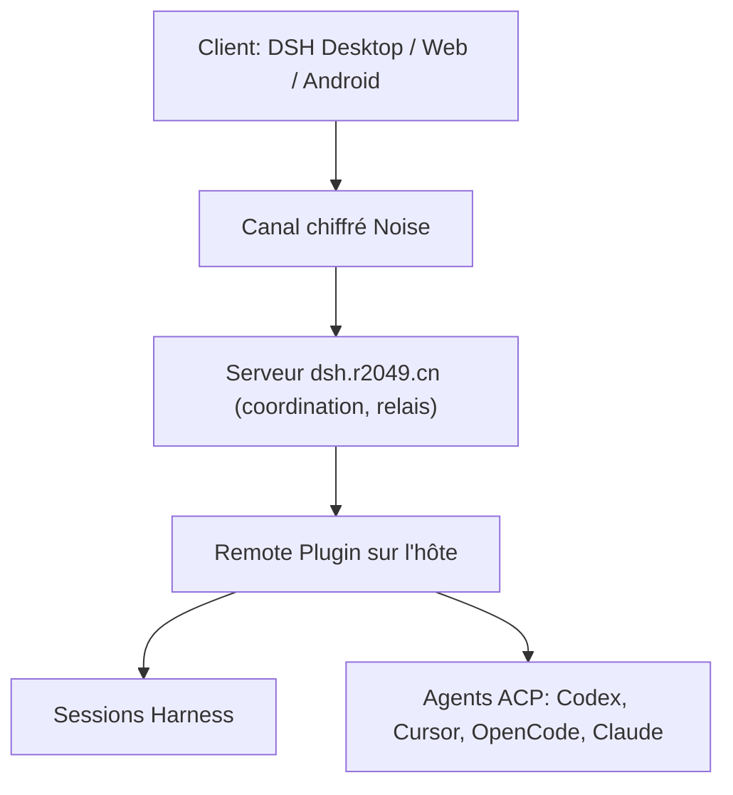

# liguobao/ds-harness-remote

> Plugin that gives you access to your DeepSeek Harness instance from a phone, a browser or another computer.

## The problem
A coding agent running on your workstation stays unreachable as soon as you move away from it, without a public port or a remote desktop.

## What it actually does
A plugin on the host machine opens an outbound connection encrypted end to end (Noise). It negotiates the path in the order LAN, P2P, TURN, then WebSocket relay. The Android, iOS, Web and DSH clients connect to it to open workspaces, read files and use a terminal. Codex, Cursor, OpenCode, Claude and other agents are reachable via ACP.

## How it is wired

## Trying it
No command documented in the README, apart from version `ds-harness-remote@0.6.3` and the one-command Linux installation, obtained after logging in at https://dsh.r2049.cn.

## Cost and gotchas
The default hosted server requires an account (sign-up requires an invitation code to be requested from the author). The self-hosted server is minimal, and TURN requires your own coturn. The Linux installer sets up a systemd service as root: remote terminals run with those privileges.

## What it is not
It is not an official DeepSeek product: the README calls it an independent community project. It is neither a remote desktop nor a simple tunnel: only the Harness interface messages travel through. No license is declared.

## Alternatives
Tailscale, CF Turn and UU Remote, cited as valid solutions depending on the need; frp and classic tunnels are also mentioned.

## For you
Ignore: tightly tied to DeepSeek Harness, with invitation-only sign-up, root access at installation and no license.
