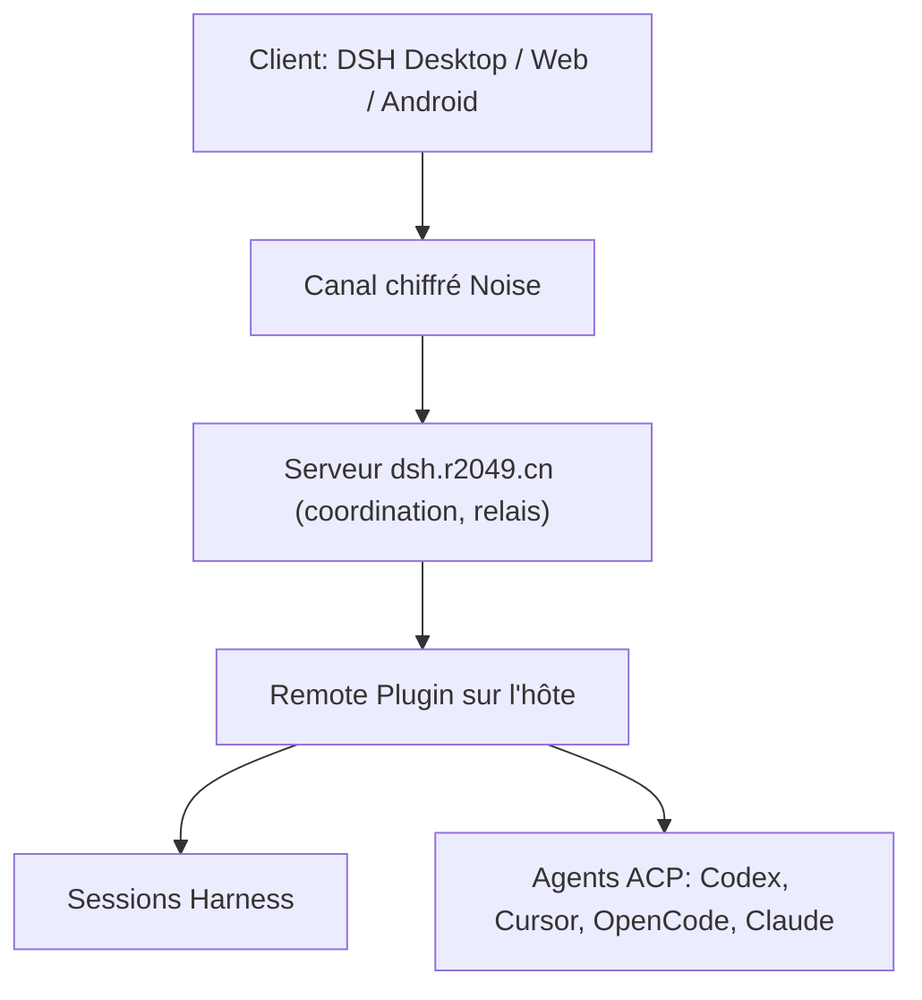

# liguobao/ds-harness-remote

> Plugin qui donne accès à ton instance DeepSeek Harness depuis un téléphone, un navigateur ou un autre ordinateur.

## Le problème
Un agent de code qui tourne sur ton poste de travail reste inaccessible dès que tu t'en éloignes, sans port public ni bureau à distance.

## Ce que ça fait vraiment
Un plugin sur la machine hôte ouvre une connexion sortante chiffrée de bout en bout (Noise). Elle négocie le chemin dans l'ordre LAN, P2P, TURN puis relais WebSocket. Les clients Android, iOS, Web et DSH s'y connectent pour ouvrir les espaces de travail, lire des fichiers et utiliser un terminal. Des agents Codex, Cursor, OpenCode, Claude et d'autres sont atteignables via ACP.

## Comment c'est branché

## Essayer
Aucune commande documentée dans le README, hors la version `ds-harness-remote@0.6.3` et l'installation Linux en une commande, obtenue après connexion sur https://dsh.r2049.cn.

## Coût et pièges
Le serveur hébergé par défaut exige un compte (l'inscription demande un code d'invitation à demander à l'auteur). Le serveur auto-hébergé est minimal, et TURN demande ton propre coturn. L'installateur Linux configure un service systemd en root : les terminaux distants tournent avec ces privilèges.

## Ce que ce n'est pas
Ce n'est pas un produit officiel de DeepSeek : le README le dit projet communautaire indépendant. Ce n'est ni un bureau à distance ni un simple tunnel : seuls les messages de l'interface Harness circulent. Aucune licence n'est déclarée.

## Alternatives
Tailscale, CF Turn et UU Remote, cités comme solutions valables selon le besoin ; frp et les tunnels classiques sont aussi mentionnés.

## Pour toi
À ignorer : très lié à DeepSeek Harness, avec inscription sur invitation, accès root à l'installation et licence absente.

