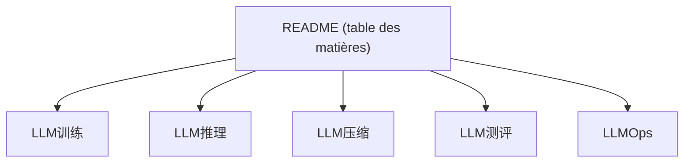

# liguodongiot/llm-action

> Chinese-language collection of articles and tutorials on LLM training, inference and compression.

## The problem
LLM engineering resources (fine-tuning, parallelism, quantization, inference) are scattered.

## What it actually does
An index of categorized articles and code: training and fine-tuning (LoRA, QLoRA, RLHF), distributed parallelism, inference engines (vLLM, SGLang, TensorRT-LLM), optimizations (KV cache, FlashAttention), quantization, pruning, distillation, evaluation, adaptation to Ascend chips, LLMOps, interview questions. Some sections are marked "to be updated".

## How it is wired
Not applicable: a repository of links, no diagram provided.

## Trying it
No documented command: browse the README and open the linked articles.

## Cost and gotchas
Free. Content is in Chinese; some sections are empty; a WeChat group and an official account are promoted.

## What it is not
Not a unified executable codebase: scattered external articles and associated code.

## Alternatives
- llm-resource and ai-system: other collections by the same author.

## For you
Worth watching: a useful catalog for inference and quantization if you read Chinese, otherwise a language barrier.
