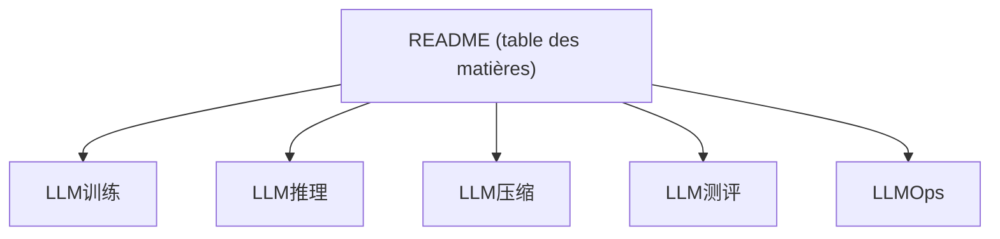

# liguodongiot/llm-action

> Recueil en chinois d'articles et tutoriels sur l'entraînement, l'inférence et la compression des LLM.

## Le problème
Les ressources d'ingénierie LLM (fine-tuning, parallélisme, quantification, inférence) sont éparpillées.

## Ce que ça fait vraiment
Index d'articles et de code classés : entraînement et fine-tuning (LoRA, QLoRA, RLHF), parallélisme distribué, moteurs d'inférence (vLLM, SGLang, TensorRT-LLM), optimisations (KV cache, FlashAttention), quantification, élagage, distillation, évaluation, adaptation aux puces Ascend, LLMOps, questions d'entretien. Quelques rubriques marquées « à mettre à jour ».

## Comment c'est branché
Non applicable : dépôt de liens, sans diagramme fourni.

## Essayer
Aucune commande documentée : parcourir le README et ouvrir les articles liés.

## Coût et pièges
Gratuit. Contenu en chinois ; certaines sections vides ; groupe WeChat et compte public promus.

## Ce que ce n'est pas
Pas un code exécutable unifié : des articles externes et du code associé épars.

## Alternatives
- llm-resource et ai-system : autres recueils du même auteur.

## Pour toi
À surveiller : catalogue utile pour l'inférence et la quantification si tu lis le chinois, sinon barrière de langue.

