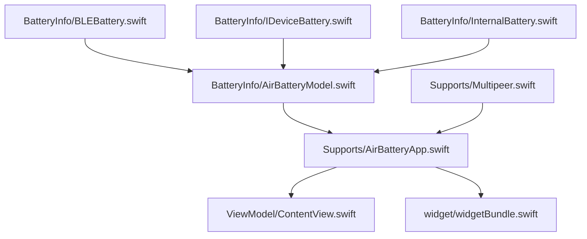

# lihaoyun6/AirBattery

> macOS application that shows the battery of Apple devices and peripherals in the Dock, the menu bar and widgets.

## The problem
Checking the battery level of an iPhone, an Apple Watch or a Bluetooth keyboard means opening several settings screens.

## What it actually does
Several readers (Bluetooth LE, iOS devices via libimobiledevice, internal battery, Magic peripherals) feed a common model, displayed in the Dock, the menu bar and widgets. The Nearcast feature shares the state with other Macs on the local network through Multipeer. An iPhone must trust the Mac and be on the same network.

## How it is wired


## Trying it
```bash
brew install lihaoyun6/tap/airbattery
```

## Cost and gotchas
Free. macOS 11 or later. Bluetooth permission requested to read peripheral packets; an iPhone must have been plugged in by cable at least once to pair. Last push in November 2025, AGPL license.

## What it is not
Not a fleet monitoring tool: it only tracks devices within range. The Apple Watch cannot be read through an iPhone discovered only over Bluetooth.

## Alternatives
No alternative cited in the README.

## For you
Ignore: small consumer macOS utility, unrelated to your field.
