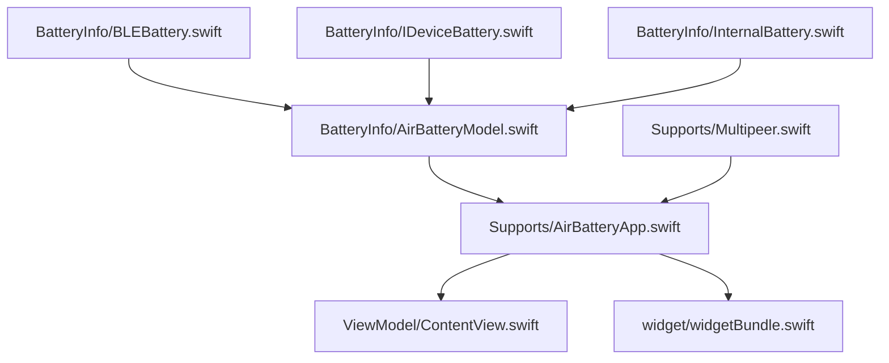

# lihaoyun6/AirBattery

> Application macOS qui affiche la batterie des appareils Apple et périphériques dans le Dock, la barre de menus et les widgets.

## Le problème
Connaître le niveau de batterie d'un iPhone, d'une Apple Watch ou d'un clavier Bluetooth oblige à ouvrir plusieurs réglages.

## Ce que ça fait vraiment
Plusieurs lecteurs (Bluetooth LE, appareils iOS via libimobiledevice, batterie interne, périphériques Magic) alimentent un modèle commun, affiché dans le Dock, la barre de menus et des widgets. La fonction Nearcast partage l'état avec d'autres Macs du réseau local via Multipeer. Un iPhone doit faire confiance au Mac et se trouver sur le même réseau.

## Comment c'est branché


## Essayer
```bash
brew install lihaoyun6/tap/airbattery
```

## Coût et pièges
Gratuit. macOS 11 ou plus. Permission Bluetooth demandée pour lire les paquets des périphériques ; un iPhone doit avoir été branché au moins une fois par câble pour s'apparier. Dernier push en novembre 2025, licence AGPL.

## Ce que ce n'est pas
Pas un outil de supervision de parc : il ne suit que les appareils à portée. L'Apple Watch ne se lit pas par un iPhone découvert seulement en Bluetooth.

## Alternatives
Aucune alternative citée dans le README.

## Pour toi
Ignorer : petit utilitaire macOS grand public, sans lien avec ton métier.

