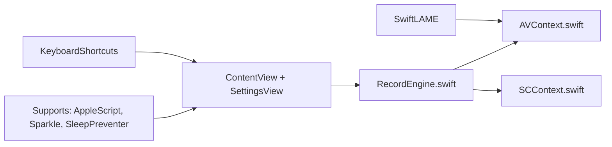

# lihaoyun6/QuickRecorder

> Lightweight screen recorder for macOS: screens, windows, applications and mobile devices.

## The problem
Recording a Mac's screen with system sound without an audio loopback driver.

## What it actually does
Captures screen, window, application or mobile device, with loopback audio without a driver, mouse highlighting, screen magnifier and camera overlay (Presenter Overlay on macOS 14). It can write HEVC with an alpha channel. By default the microphone is mixed into the main track; an option splits it onto two tracks. Not sandboxed, the app is not intended for the App Store.

## How it is wired


## Trying it
```bash
brew install lihaoyun6/tap/quickrecorder
```

## Cost and gotchas
Free. macOS 12.3 minimum. Last push in June 2025, 180 open issues.

## What it is not
Not a video editor. The HEVC alpha is only read by iMovie and Final Cut Pro according to the README.

## Alternatives
No alternative named in the README.

## For you
Ignore: macOS screen recorder unrelated to data/AI work, AGPL-3.0 license and activity stopped for over a year.
