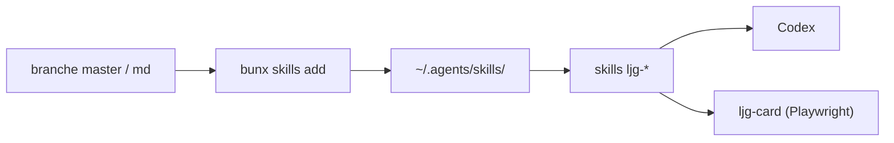

# lijigang/ljg-skills

> Personal collection of Codex skills in Chinese: concept analysis, reading, PNG cards.

## The problem
Structuring your reading and notes with an agent relies on instructions rewritten each time.

## What it actually does
About thirty skills named `ljg-*`: analogy, blind-spot scan, business model canvas, PNG cards (`ljg-card`), paper and book reading, knowledge cards, round tables, HTML presentation. Two branches: `master` in org-mode, `md` in Markdown. `ljg-card` requires Playwright; `ljg-business-model` requires Bun.

## How it is wired


## Trying it
```bash
bunx skills add lijigang/ljg-skills -g -a codex --skill '*' -y
cd ~/.agents/skills/ljg-card && bun install && bunx playwright install chromium
```

## Cost and gotchas
Free; Bun required, Chromium to download for the cards. Content entirely in Chinese, with no security note.

## What it is not
Not a data tool: these are writing and thinking instructions, centered on note-reading.

## Alternatives
No alternative named in the README.

## For you
Ignore for a data/AI profile: personal-reflection skills, in Chinese, of little use to a pipeline.
