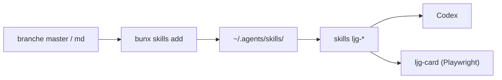

# lijigang/ljg-skills

> Collection personnelle de skills Codex en chinois : analyse de concepts, lecture, cartes en PNG.

## Le problème
Structurer sa lecture et ses notes avec un agent repose sur des consignes à réécrire à chaque fois.

## Ce que ça fait vraiment
Une trentaine de skills nommés `ljg-*` : analogie, scan de angles morts, canevas de modèle économique, cartes PNG (`ljg-card`), lecture de papiers et de livres, cartes de connaissances, tables rondes, présentation HTML. Deux branches : `master` en org-mode, `md` en Markdown. `ljg-card` demande Playwright ; `ljg-business-model` demande Bun.

## Comment c'est branché


## Essayer
```bash
bunx skills add lijigang/ljg-skills -g -a codex --skill '*' -y
cd ~/.agents/skills/ljg-card && bun install && bunx playwright install chromium
```

## Coût et pièges
Gratuit ; Bun nécessaire, Chromium à télécharger pour les cartes. Contenu entièrement en chinois, sans note de sécurité.

## Ce que ce n'est pas
Ce n'est pas un outil data : ce sont des consignes d'écriture et de réflexion, centrées sur la lecture de notes.

## Alternatives
Aucune alternative nommée dans le README.

## Pour toi
À ignorer pour un profil data/IA : skills de réflexion personnelle, en chinois, peu utiles à un pipeline.

