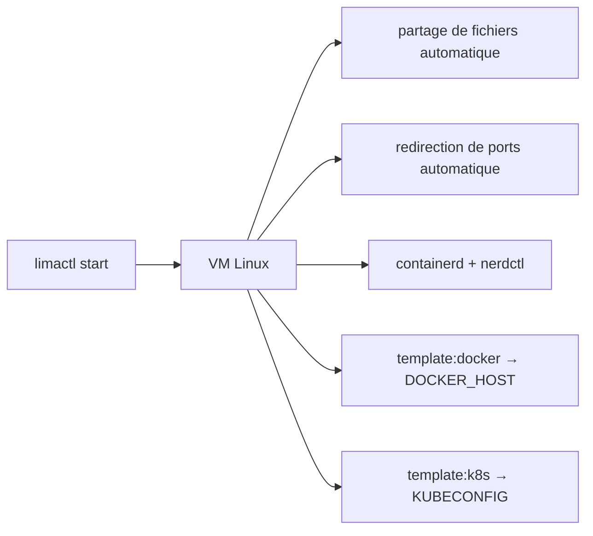

# lima-vm/lima

> Linux virtual machines with automatic file sharing and port forwarding, WSL2-style.

## The problem
On a macOS workstation, running containers requires a Linux VM, and setting it up by hand
means handling file sharing and port forwarding yourself.

## What it actually does
`limactl start` launches a Linux VM; `lima <command>` runs it inside. Templates cover the
container engines: `template:docker` (with a `DOCKER_HOST` on a local socket), `template:k8s`
(with a `KUBECONFIG` copied from the guest), and containerd/nerdctl by default. The initial goal
was to promote containerd and nerdctl to Mac users, but Lima is also used outside
containers and runs on Linux and NetBSD. Since v2.3, releases ship CycloneDX SBOMs,
in "app" (dependencies actually compiled) and "mod" (module aggregate) variants.

## How it is wired


## Trying it
```bash
brew install lima
limactl start
lima uname -a
lima nerdctl run --rm hello-world
limactl start template:docker
export DOCKER_HOST=$(limactl list docker --format 'unix://{{.Dir}}/sock/docker.sock')
```

## Cost and gotchas
Free. The cost is that of a VM: RAM and disk reserved on the workstation. The README details neither
the hardware prerequisites nor the license, and refers fine configuration to the documentation.

## What it is not
Not a container engine: Lima provides the VM, and containerd, Docker or Kubernetes run inside.
Not a graphical interface — the README points to third-party projects for that. Not exclusively macOS.

## Alternatives
- Colima: Docker and Kubernetes on macOS with minimal configuration.
- Rancher Desktop: Kubernetes and container management with a desktop interface.
- Podman Desktop: has a plugin for Lima VMs.

## For you
The clean base for a reproducible containerized environment on a workstation, without Docker Desktop.
