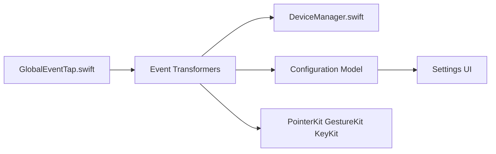

# linearmouse/linearmouse

> macOS utility to tune the mouse and trackpad (speed, scrolling, buttons).

## The problem
macOS applies fixed acceleration and scrolling that suit some external mice poorly.

## What it actually does
The README is very short (link to linearmouse.app, contribution guide, translation via Crowdin). From the code: events intercepted by a global Event Tap, a chain of transformers (buttons, scrolling, pointer), per-device handling, template-based configuration, Swift modules GestureKit, KeyKit and PointerKit. Requires macOS accessibility permission.

## How it is wired

## Trying it
No command documented in the README: see https://linearmouse.app.

## Cost and gotchas
Free. Requires macOS Accessibility access (event interception).

## What it is not
Not a cross-platform application: macOS only. The README does not detail the features.

## Alternatives
Mac Mouse Fix, cited as a source of inspiration for pointer speed.

## For you
Ignore: comfort utility on Mac, unrelated to data/AI/MLOps work.
