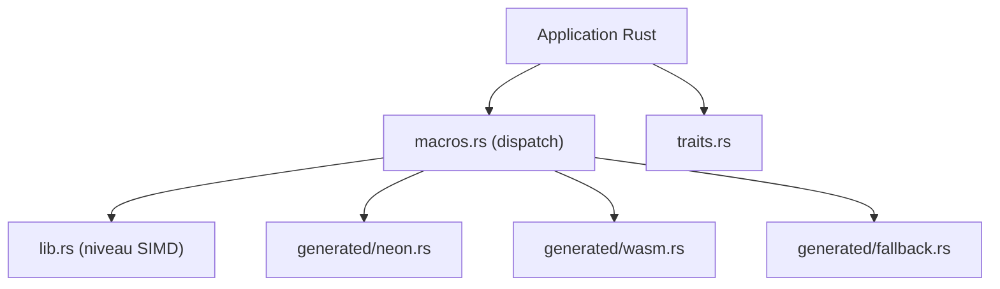

# linebender/fearless_simd

> Rust library for writing SIMD safely, with very little `unsafe` code.

## The problem
SIMD in Rust goes through `unsafe` intrinsics and per-architecture variants.

## What it actually does
Provides vector traits and types, dispatch based on the detected SIMD level (x86, NEON, Wasm, scalar fallback) and an optional `#[simd]` attribute via `fearless_simd_macros`. A generator produces the repetitive parts and tests check that all implementations give the same results.

## How it is wired


## Trying it
```bash
# Aucune commande dans ce README : voir le README du paquet fearless_simd.
```

## Cost and gotchas
Free. Rust only. The repository README is provisional; usage is detailed in the package README.

## What it is not
Not a numerical computing library: it is a low-level building block for writing your own kernels.

## Alternatives
- pulp: inspiration crate and similar approach, cited in the README.
- std::simd: Rust standard module cited in the README.

## For you
Relevant if you write compute kernels in Rust; worth watching, with no direct use in Python.
