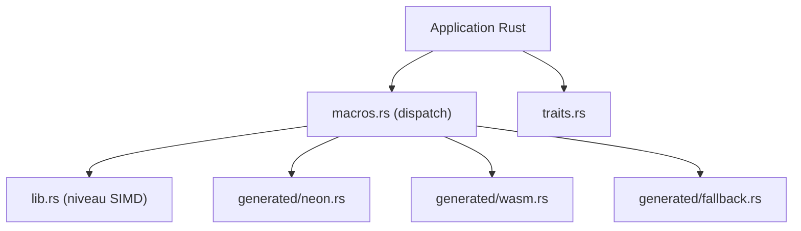

# linebender/fearless_simd

> Bibliothèque Rust pour écrire du SIMD de façon sûre, avec très peu de code `unsafe`.

## Le problème
Le SIMD en Rust passe par des intrinsèques `unsafe` et des variantes par architecture.

## Ce que ça fait vraiment
Offre des traits et types vectoriels, un dispatch selon le niveau SIMD détecté (x86, NEON, Wasm, repli scalaire) et un attribut `#[simd]` optionnel via `fearless_simd_macros`. Un générateur produit les parties répétitives et les tests vérifient que toutes les implémentations donnent les mêmes résultats.

## Comment c'est branché


## Essayer
```bash
# Aucune commande dans ce README : voir le README du paquet fearless_simd.
```

## Coût et pièges
Gratuit. Rust uniquement. Le README du dépôt est provisoire ; l'usage est détaillé dans le README du paquet.

## Ce que ce n'est pas
Pas une bibliothèque de calcul numérique : c'est une brique bas niveau pour écrire ses propres noyaux.

## Alternatives
- pulp : crate d'inspiration et approche voisine, citée au README.
- std::simd : module standard Rust cité au README.

## Pour toi
Pertinent si tu écris des noyaux de calcul en Rust ; à surveiller, sans usage direct en Python.

