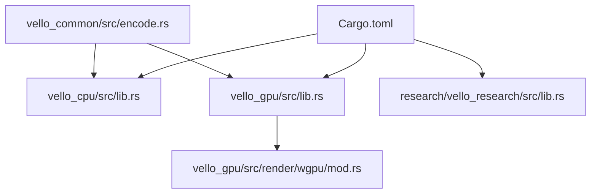

# linebender/vello

> 2D vector rendering engines in Rust (CPU, GPU, compute) for UI and graphics developers.

## The problem
Drawing vector shapes, gradients, images and text quickly, on CPU as well as GPU, without depending on Skia or Cairo.

## What it actually does
Three engines: `vello_cpu` (multithreaded, SIMD, the most mature), `vello_gpu` (CPU preprocessing, GPU rasterization via wgpu or WebGL2, without compute shaders) and the legacy `vello` using compute shaders, experimental, in `research/`. The first two share `vello_common`. The WESL shaders are compiled by `vello_gpu_shaders`.

## How it is wired
Diagram based on the one provided.



## Trying it
```bash
cargo run -p vello_cpu_winit --release
cargo run -p vello_gpu_winit --release
cargo run -p with_winit --release
```

## Cost and gotchas
Free. Rust 1.89 or later. The GPU matters only for `vello_gpu` and the compute engine, which remains experimental.

## What it is not
Not a UI framework or a 3D engine: it only draws 2D vector graphics. `vello_gpu` is not yet the reference engine.

## Alternatives
- Skia: vector renderer with the same role.
- Cairo: vector renderer with the same role.
- Piet: predecessor project.

## For you
Worth watching: an interesting Rust graphics engine to follow, but with no direct use in data/AI work, except embedded visualization.
