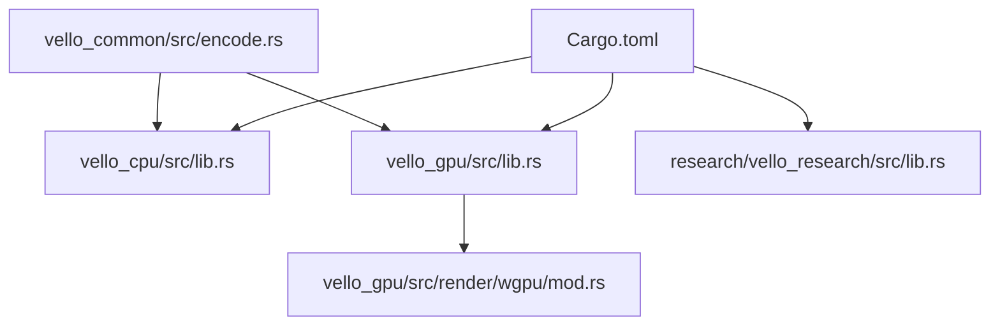

# linebender/vello

> Moteurs de rendu vectoriel 2D en Rust (CPU, GPU, compute) pour développeurs d'interfaces et de graphismes.

## Le problème
Dessiner formes, dégradés, images et texte vectoriels vite, sur CPU comme sur GPU, sans dépendre de Skia ou Cairo.

## Ce que ça fait vraiment
Trois moteurs : `vello_cpu` (multithread, SIMD, le plus mûr), `vello_gpu` (prétraitement CPU, rastérisation GPU via wgpu ou WebGL2, sans compute shaders) et `vello` historique en compute shaders, expérimental, dans `research/`. Les deux premiers partagent `vello_common`. Les shaders WESL sont compilés par `vello_gpu_shaders`.

## Comment c'est branché
Schéma d'après le diagramme fourni.



## Essayer
```bash
cargo run -p vello_cpu_winit --release
cargo run -p vello_gpu_winit --release
cargo run -p with_winit --release
```

## Coût et pièges
Gratuit. Rust 1.89 ou plus. Le GPU est utile seulement pour `vello_gpu` et le moteur compute, qui reste expérimental.

## Ce que ce n'est pas
Pas un framework d'interface ni un moteur 3D : il ne dessine que du 2D vectoriel. `vello_gpu` n'est pas encore le moteur de référence.

## Alternatives
- Skia : renderer vectoriel de même rôle.
- Cairo : renderer vectoriel de même rôle.
- Piet : projet prédécesseur.

## Pour toi
À surveiller : un moteur graphique Rust intéressant à suivre, mais sans usage direct dans un travail data/IA, sauf visualisation embarquée.

