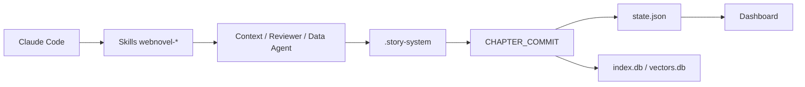

# lingfengQAQ/webnovel-writer

> Claude Code plugin for writing long Chinese serial novels while keeping the narrative consistent.

## The problem
Beyond a few dozen chapters, an LLM forgets characters, timeline and subplots.

## What it actually does
Eight commands (`/webnovel-init`, `-plan`, `-write`, `-review`, `-query`, `-learn`, `-dashboard`, `-doctor`) orchestrate context, reviewer and data agents.
Each chapter produces a `CHAPTER_COMMIT` in `.story-system/`, the single source of truth, projected to `state.json`, `index.db`, summaries and memory.
Search combines RAG (OpenAI-compatible embedding + rerank) with a BM25 fallback.
A read-only React dashboard shows the project state; 37 Chinese genre templates.

## How it is wired


## Trying it
```bash
claude plugin marketplace add lingfengQAQ/webnovel-writer --scope user
claude plugin install webnovel-writer@webnovel-writer-marketplace --scope user
python -m pip install -r https://raw.githubusercontent.com/lingfengQAQ/webnovel-writer/HEAD/requirements.txt
cp .env.example .env
```

## Cost and gotchas
Claude Code subscription and embedding/rerank keys at your own expense; README sponsored by API resellers.
The master branch is in maintenance (v6), v8 is in progress on a different base.

## What it is not
Not a general-purpose writing tool: designed for Chinese web fiction, documentation in Chinese.
Cannot be used outside Claude Code.

## Alternatives
No alternative named in the README (only `oh-story-claudecode` is cited as inspiration).

## For you
Ignore for your profile: literary use case is off-topic, even though the "event commit + projections" pattern is an agent-memory idea worth remembering.
