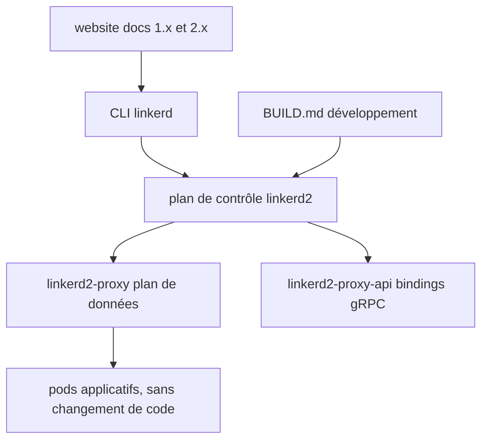

# linkerd/linkerd2

> Lightweight, security-focused Kubernetes service mesh, with no changes to application code.

## The problem
Encrypting communication between services, observing them and making them reliable usually means touching every application.
The service meshes offered to address this are themselves heavy to operate.

## What it actually does
Adds security, observability and reliability to a Kubernetes stack with no code change, according to the README.
This repository contains the control plane and the CLI of the 2.x line; the data plane proxy lives in `linkerd2-proxy`, the gRPC bindings in `linkerd2-proxy-api`.
The README is a routing page: installation and usage are delegated to the Getting Started Guide and the `website` repository.
A CNCF project, with a steering committee, public meetings and published third-party security audits.

## How it is wired

## Trying it
No command documented in this README: it points to the Getting Started Guide and to `BUILD.md`.

## Cost and gotchas
Free and CNCF; a "modern" Kubernetes cluster is required, so the cost is that of the infrastructure.
Reading trap: this README documents nothing operational, everything is in the `website` repository.

## What it is not
Not Linkerd 1.x: that one lives in the separate `linkerd` repository.
Not the proxy: the data plane is not in this repository.
Not documentation: it is an index page pointing to the guides and community channels.

## Alternatives
- linkerd (1.x): the previous line, if you are outside Kubernetes.

## For you
Worth knowing by name for mTLS between services; this README is not enough to decide, you have to go to the website.
