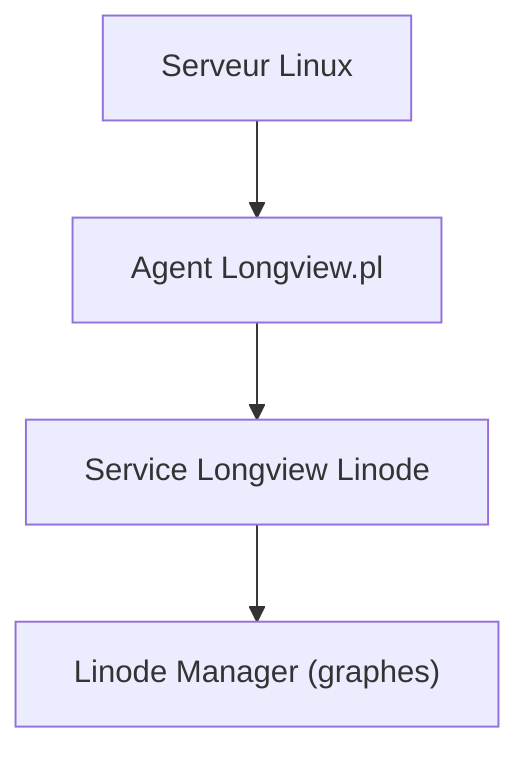

# linode/longview

> Perl agent that sends a Linux server's statistics to Linode's Longview service for display.

## The problem
Tracking CPU, memory, disk, network and processes across several servers requires a collection and graphing system.

## What it actually does
An open source Perl agent, installed in `/opt/linode/longview`, collects system statistics (CPU, memory, disk I/O, listening services, connections, traffic, processes) and sends them to the hosted service. Graphs are viewed in the Linode Manager. The Pro plan keeps data without limit at 1-minute resolution; the Free plan keeps 12 hours at 5 minutes.

## How it is wired
Simplified diagram based on the sheet, no diagram provided.



## Trying it
```bash
service longview start
/opt/linode/longview/Linode/Longview.pl debug
service longview stop
```

## Cost and gotchas
Linode account required and API key placed in `/etc/linode/longview.key`; the Free plan only keeps 12 hours. Perl 5.8+ and kernel 2.6+. The catalog shows the repository as archived, while the README mentions a maintenance mode.

## What it is not
Not a standalone tool: without the Linode service, data is not displayed. No new features planned.

## Alternatives
No alternative named in the README.

## For you
Ignore: agent tied to a SaaS, in maintenance and archived; an MLOps person would prefer an independent metrics stack.
