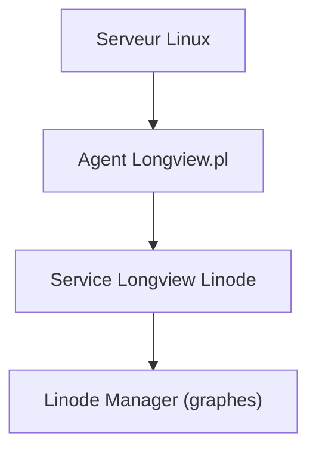

# linode/longview

> Agent Perl qui envoie les statistiques d'un serveur Linux au service Longview de Linode pour les afficher.

## Le problème
Suivre CPU, mémoire, disque, réseau et processus de plusieurs serveurs demande un système de collecte et de graphes.

## Ce que ça fait vraiment
Un agent Perl open source, installé dans `/opt/linode/longview`, collecte les statistiques système (CPU, mémoire, E/S disque, services à l'écoute, connexions, trafic, processus) et les transmet au service hébergé. Les graphes se consultent dans le Linode Manager. L'offre Pro garde les données sans limite à 1 minute de résolution ; l'offre Free conserve 12 heures à 5 minutes.

## Comment c'est branché
Schéma simplifié d'après la fiche, sans diagramme fourni.



## Essayer
```bash
service longview start
/opt/linode/longview/Linode/Longview.pl debug
service longview stop
```

## Coût et pièges
Compte Linode requis et clé d'API déposée dans `/etc/linode/longview.key` ; l'offre Free garde seulement 12 heures. Perl 5.8+ et noyau 2.6+. Le catalogue indique le dépôt archivé, alors que le README parle d'un mode maintenance.

## Ce que ce n'est pas
Pas un outil autonome : sans le service Linode, les données ne sont pas affichées. Pas de nouvelles fonctions prévues.

## Alternatives
Aucune alternative nommée dans le README.

## Pour toi
À ignorer : agent lié à un SaaS, en maintenance et archivé ; un MLOps préférera une pile de métriques indépendante.

