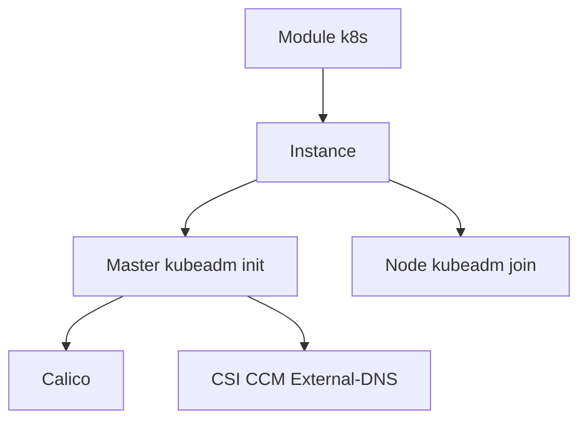

# linode/terraform-linode-k8s

> Terraform module that creates a Kubernetes cluster on Linode instances, marked experimental.

## The problem
Setting up a Kubernetes cluster with kubeadm on Linode by hand is time-consuming.

## What it actually does
Provisions Ubuntu instances, installs kubeadm, kubectl, kubelet and crictl over SSH, a Calico network, then the Linode components (CSI, CCM, External-DNS) and add-ons (dashboard, Metrics Server). Three submodules: Instance, Master, Node. Validated Kubernetes versions from 1.16 to 1.19.

## How it is wired
Simplified diagram based on the sheet, no diagram provided.



## Trying it
```bash
terraform workspace new linode
terraform apply -var region=eu-west -var server_type_master=g6-standard-2 -var nodes=1 -var server_type_node=g6-standard-2
terraform apply -var nodes=3
terraform destroy -force
```

## Cost and gotchas
Linode API token and billed instances. A module update may replace all nodes and cause data loss. Volumes and NodeBalancers created by Kubernetes must be cleaned up by hand.

## What it is not
The README warns: experimental, not for production. Old Kubernetes versions.

## Alternatives
None cited in the README.

## For you
Ignore: archived, experimental, pinned to Kubernetes 1.16 to 1.19.
