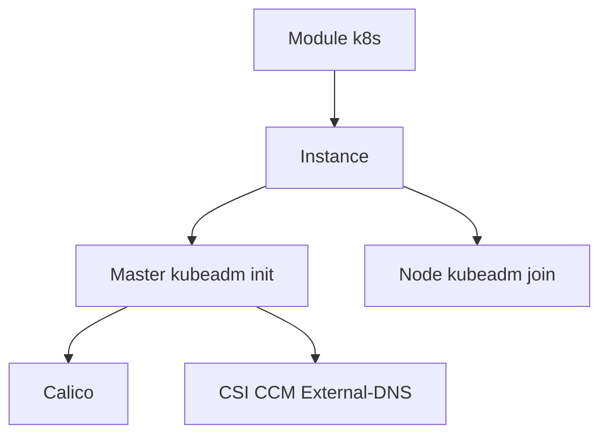

# linode/terraform-linode-k8s

> Module Terraform créant un cluster Kubernetes sur des instances Linode, marqué expérimental.

## Le problème
Monter un cluster Kubernetes avec kubeadm sur Linode à la main est long.

## Ce que ça fait vraiment
Provisionne des instances Ubuntu, installe kubeadm, kubectl, kubelet et crictl par SSH, un réseau Calico, puis les composants Linode (CSI, CCM, External-DNS) et les add-ons (dashboard, Metrics Server). Trois sous-modules : Instance, Master, Node. Versions validées de Kubernetes de 1.16 à 1.19.

## Comment c'est branché
Schéma simplifié d'après la fiche, sans diagramme fourni.



## Essayer
```bash
terraform workspace new linode
terraform apply -var region=eu-west -var server_type_master=g6-standard-2 -var nodes=1 -var server_type_node=g6-standard-2
terraform apply -var nodes=3
terraform destroy -force
```

## Coût et pièges
Jeton d'API Linode et instances facturées. Une mise à jour du module peut remplacer tous les noeuds et faire perdre des données. Volumes et NodeBalancers créés par Kubernetes à nettoyer à la main.

## Ce que ce n'est pas
Le README prévient : expérimental, pas pour la production. Versions de Kubernetes anciennes.

## Alternatives
Aucune citée dans le README.

## Pour toi
À ignorer : archivé, expérimental, calé sur Kubernetes 1.16 à 1.19.

