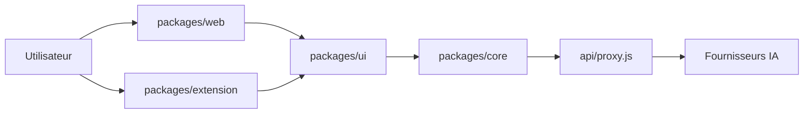

# linshenkx/prompt-optimizer

> Web app, desktop app, Chrome extension and MCP server for rewriting, testing and saving your prompts.

## The problem
A hand-written prompt is rarely good on the first try, and there is no way to measure whether a rewrite is really better.

## What it actually does
Optimizes system or user prompts over several rounds, then compares them (analysis, simple or comparative evaluation). Test mode with variables, multi-turn conversation and Function Calling; image generation (T2I, I2I). Favorites keep a version history. Everything is client-side: requests go directly to the configured model provider.

## How it is wired


## Trying it
```bash
docker run -d -p 8081:80 --restart unless-stopped --name prompt-optimizer linshen/prompt-optimizer
# ou, en développement
pnpm install
pnpm dev
```

## Cost and gotchas
The provider's API key is on you. `VITE_*` variables are exposed in the browser: do not put a key in them on a public deployment. Web versions run into CORS (the README recommends the desktop app or a proxy); the macOS app is unsigned.

## What it is not
Not a hosted service with a model included: you need your own keys. Evaluation is still produced by an LLM, not an independent benchmark. The license is not identified by GitHub: check it before any commercial use.

## Alternatives
No alternative named in the README.

## For you
Keep an eye on it: useful for iterating on AI pipeline prompts without writing tooling, but the unidentified license and the single maintainer hold back team adoption.
