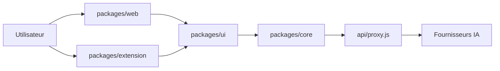

# linshenkx/prompt-optimizer

> Application web, bureau, extension Chrome et serveur MCP pour réécrire, tester et sauvegarder ses prompts.

## Le problème
Un prompt écrit à la main est rarement bon du premier coup, et on ne sait pas mesurer si une réécriture est vraiment meilleure.

## Ce que ça fait vraiment
Optimise des prompts système ou utilisateur en plusieurs tours, puis les compare (analyse, évaluation simple ou comparée). Mode test avec variables, conversation multi-tours et Function Calling ; génération d'images (T2I, I2I). Les favoris gardent l'historique de versions. Tout est côté client : les requêtes partent directement vers le fournisseur de modèle configuré.

## Comment c'est branché


## Essayer
```bash
docker run -d -p 8081:80 --restart unless-stopped --name prompt-optimizer linshen/prompt-optimizer
# ou, en développement
pnpm install
pnpm dev
```

## Coût et pièges
Clé d'API du fournisseur à ta charge. Les variables `VITE_*` sont exposées dans le navigateur : ne pas y mettre de clé sur un déploiement public. Les versions web butent sur le CORS (le README recommande l'application bureau ou un proxy) ; application macOS non signée.

## Ce que ce n'est pas
Pas un service hébergé avec modèle inclus : il faut ses propres clés. L'évaluation reste produite par un LLM, pas un benchmark indépendant. La licence n'est pas identifiée par GitHub : à vérifier avant tout usage commercial.

## Alternatives
Aucune alternative nommée dans le README.

## Pour toi
À surveiller : utile pour itérer sur des prompts de pipelines IA sans écrire d'outillage, mais la licence non identifiée et le mainteneur unique freinent une adoption en équipe.

